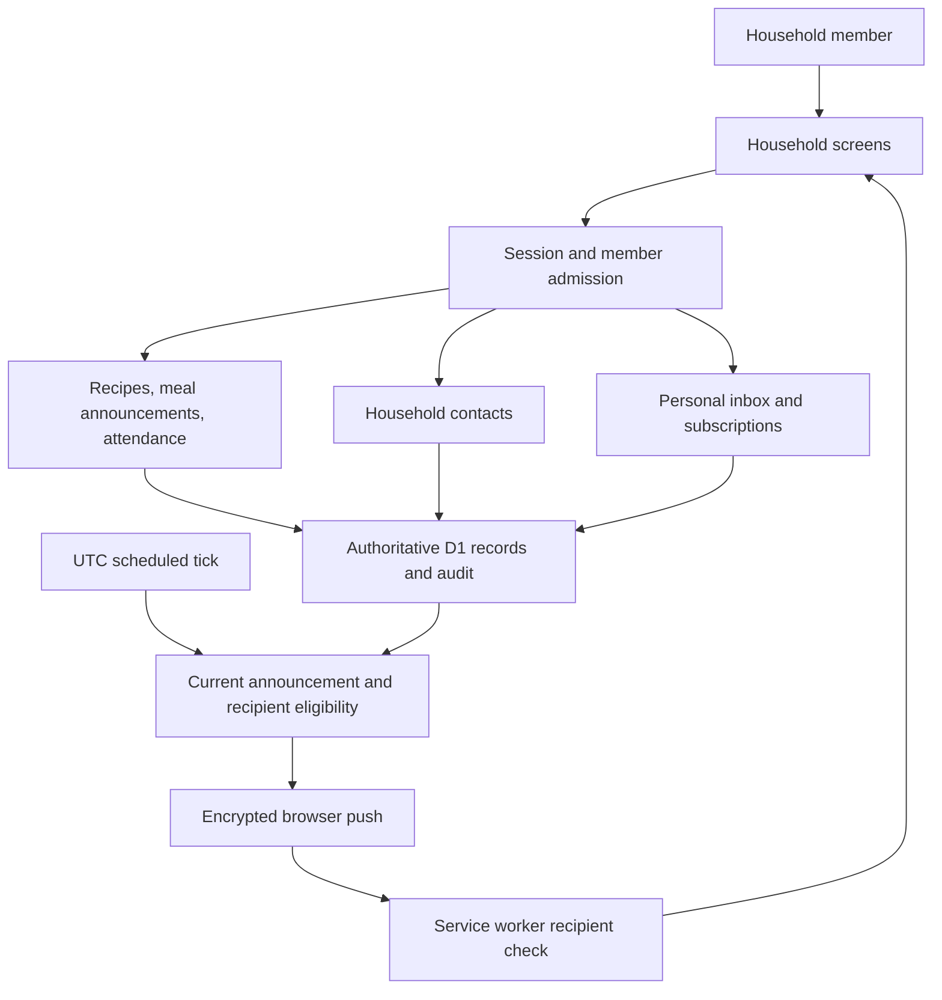
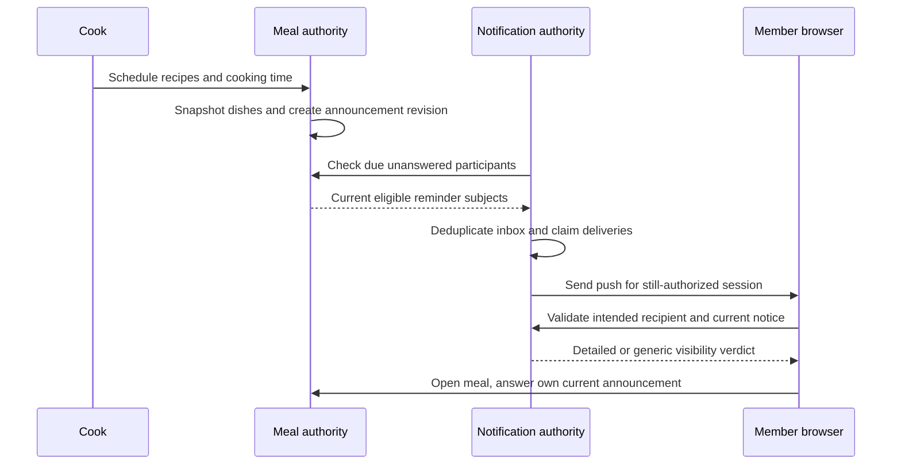
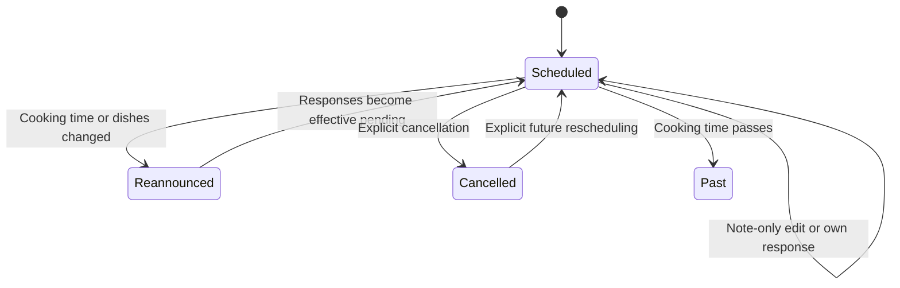
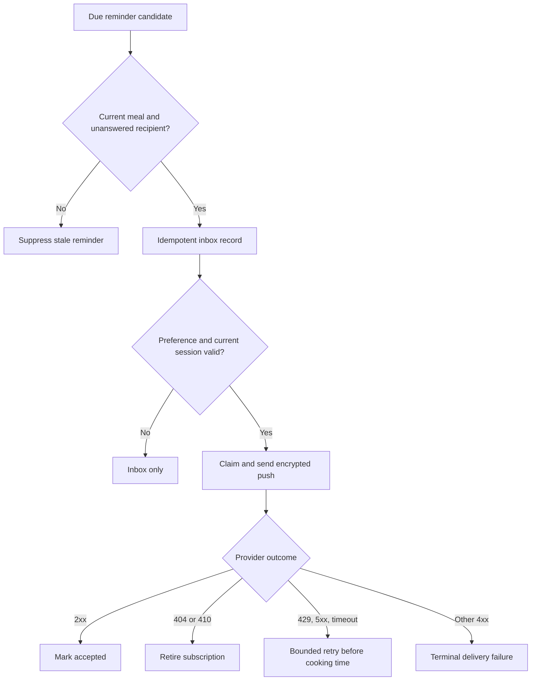

# Household Meals, Contacts, and Reminders - Plan

## Goal Capsule

- **Objective:** Household members can agree on what will be cooked during the coming week, say whether they will eat, receive timely reminders, and find their home's important contacts.
- **Means:** Extend the existing household application with reusable recipes, scheduled meals, contacts, and opt-in notifications (KTD1).
- **Authority:** The user request and established access boundaries govern product behavior; the Product Contract governs implementation; Designer-owned subsystem contracts govern structure.
- **Execution profile:** Complete implementation and verification without further product check-ins. Preserve the existing authentication, inventory, expenses, and PWA workflows.
- **Tail ownership:** The invoking shipping workflow owns review, green CI, merging existing PR #1 into `main`, production migration/deployment, and live verification at `https://home.dhruvverma.dev`.
- **Stop conditions:** Surface a proven contradiction or unavailable production authority that prevents the requested behavior. Resolve ordinary implementation choices within this plan.

---

## Product Contract

### Summary

Add a reusable recipe library and a household-local seven-day menu with cooking times, member attendance, and reminders asking unanswered members whether they will eat.
Add household contacts and a notification inbox, with real browser push available after explicit consent.
Existing member management supplies multiple owners.

### Problem Frame

The live app manages people and inventory, but household members still coordinate meals and important contacts elsewhere.
A cook cannot see who is eating, and there is no durable connection between reusable dishes, an announced cooking time, and attendance reminders.

### Actors

- A1. Home owner: manages membership and can maintain shared recipes, meals, and contacts.
- A2. Member: maintains shared cooking/contact information and answers for themselves.
- A3. Viewer: reads shared information and manages only their own notification experience.
- A4. Scheduler and browser push service: deliver reminders subject to current meal, membership, preference, and session authority.

### Requirements

**People and access**

- R1. Reuse owner/member/viewer accounts and allow multiple active owners through Members. The final active owner remains protected.
- R2. Every shared read and write remains household-authorized. Only owners and members change recipes, meals, contacts, and their own attendance; no caller answers for another member.
- R3. Viewers may change their own notification preferences, subscriptions, and inbox read state, without gaining any shared-write permission.

**Recipes and cooking plans**

- R4. Members can create, edit, search, archive, and restore recipes with a name, servings, ingredients, preparation instructions, notes/description, and optional labels.
- R5. Ingredients can optionally link to household inventory. Availability distinguishes sufficient, missing, and unknown/untracked stock and never claims sufficient stock from incompatible units or percentage-only quantities.
- R6. A meal selects one or more recipes and records a title, cooking time, household timezone, reminder lead time, and optional notes. Selected recipe content is snapshotted when explicitly selected so later recipe edits/archive do not change an announced meal.
- R7. The menu presents today/tomorrow and a navigable seven-day range grouped by household-local date. Cards show cooking time, dishes, attendance counts, and the current member's response.
- R8. Active owners/members answer yes, no, or unanswered for themselves before a scheduled meal. Counts reflect active eligible household members, while departed members' historical answers remain referable.
- R9. Changing cooking time or selected dish snapshots requires attendance reconfirmation. Note-only edits preserve answers; answering does not invalidate another member's answer.
- R10. A meal can be cancelled and visibly retained in history. Cancelled, already-cooked, or superseded announcements cannot accept fresh attendance or produce a new attendance reminder.
- R11. Scheduling or answering attendance never consumes inventory automatically.

**Contacts**

- R12. Members can create, edit, search, label, archive, and restore household contacts with a name, relationship/role, phone, email, optional address, and notes. Active contacts provide safe call/email links where those channels exist.

**Reminders and notifications**

- R13. Due reminders ask unanswered active owners/members whether they want to eat the announced dishes at the cooking time. Reminder eligibility is checked against current meal announcement, attendance, preferences, and membership before delivery.
- R14. Each member has a bounded inbox with unread/read state and links to the relevant meal. Keep at most 50 entries and 14 days of inbox history per member; deduplication records expire after seven days.
- R15. Browser notification permission is requested only after an explicit Enable notifications action. Denied, unsupported, or installation-required browsers retain the in-app inbox and clear recovery guidance.
- R16. Opted-in devices receive real encrypted Web Push when the app is closed, using the existing Worker and scheduled execution. Subscription ownership is tied to the exact continuing device session; logout, password reset, expiry, or deactivation stops future authorized sends.
- R17. Expired subscriptions are retired, transient delivery failures are retried within a bounded lifetime, and overlapping scheduler runs do not normally duplicate reminders. The product does not promise exactly-once external push delivery.
- R18. Notification clicks open a same-origin meal link that survives sign-in. Before displaying private household details, the service worker verifies that the current recipient/session is still entitled; otherwise it shows a generic visible notification.

**Reliability and delivery**

- R19. New screens have loading, empty, retry, validation, conflict, archive/cancel, and permission states. A stale response must not display success or repopulate another member's device copy.
- R20. Saved recipes, menu, and contacts can be read offline in the current member's device boundary. New-domain writes require a connection and must not masquerade as queued inventory writes.
- R21. The release is reviewed, tested, merged, deployed to the primary custom domain, and verified without creating production owner credentials on the user's behalf.

### Key Flows

- F1. A member creates a recipe, optionally links ingredients to inventory, selects it with other dishes for a future meal, then sees the announcement in the week menu. Covers R4-R7, R11.
- F2. A member opens a meal, answers yes/no, and sees current household totals. A substantive announcement edit returns prior responses to effective unanswered. Covers R8-R10.
- F3. A due reminder creates one inbox entry and eligible push delivery; its link reaches the current meal after sign-in. Covers R13-R18.
- F4. A member finds an important contact, calls/emails, and can archive or restore the record. Covers R12, R19.

### Acceptance Examples

- AE1. A dinner scheduled for tomorrow in the household timezone shows the selected dal and rice recipe snapshots. Editing the dal recipe later leaves that dinner unchanged. Covers R6-R7.
- AE2. Two active members answer yes and no. Changing only notes preserves both answers; changing the cooking time makes both effectively unanswered until reconfirmed. Covers R8-R9.
- AE3. A reminder is selected, then the meal is cancelled or the recipient answers. The stale pending reminder cannot disclose or send the outdated question. Covers R10, R13.
- AE4. A device opts into push, then logs out or changes account. Future delivery is suppressed; an already-in-flight message may show only generic details unless recipient validation succeeds. Covers R16-R18.
- AE5. A viewer attempts to edit a recipe or answer attendance and is refused, but can disable their own notifications and mark their own inbox entry read. Covers R2-R3.

### Scope Boundaries

The release concerns one existing household. It does not add public signup, production seed accounts, recipe scraping, automatic pantry consumption, paid notification providers, email delivery, meal payments, or guest attendance.

#### Deferred to Follow-Up Work

MCP read/write tools for the new domains, scoped OAuth, quiet-hours scheduling, and richer expense settlement remain separate work. Existing MCP remains independently authenticated and read-only; its existing audit tool may expose non-secret activity records for new shared commands.

---

## Planning Contract

### Assumptions

- The household's existing timezone is authoritative and defaults to `Asia/Kolkata`; no separate timezone settings feature is needed in this release.
- Owners and members may maintain shared cooking/contact information. Viewers remain read-only for attendance, with the narrow personal exceptions in R3.
- A reminder lead time defaults to 60 minutes and is configurable per meal, bounded to 1-10,080 minutes. Creating or rescheduling a meal after its reminder time may generate a catch-up reminder before cooking begins.
- Push delivery requires an unexpired sign-in on that device. Reauthentication can rebind an existing native subscription after explicit prior browser consent; it cannot silently request permission.
- No production account email/password is supplied; private first-owner setup remains the user's choice.

### Key Technical Decisions

- KTD1. **Keep domain boundaries small and reuse the platform.** Worker responsibilities live under `src/meals`, `src/contacts`, and `src/notifications`; new frontend features live under `src/household`. Designer contracts own their boundaries. Reuse Hono, D1, session admission, command context, audit, and the existing request helper instead of a new service or frontend framework. Governs R1-R3, R19-R21.
- KTD2. **Separate recipe definitions, meal announcements, and personal responses.** A meal has a shared optimistic version and an announcement version. Each member response has its own version and the announcement version it answers. Effective pending state follows a mismatched announcement without deleting historical proof. This prevents one response from conflicting with all other members and preserves R6, R8-R10.
- KTD3. **Use UTC instants with household-local calendar boundaries.** Persist canonical UTC cooking times and the stored household IANA timezone. The server fills that zone or rejects a supplied different zone, even if the supplied zone is valid. Convert datetime-local input explicitly in the household zone, round-trip validate it, and reject nonexistent/ambiguous local input instead of using the browser zone implicitly. Range queries derive half-open UTC bounds from household-local dates. Governs R6-R7. Existing household timezone is in `apps/worker/migrations/0001_platform_inventory.sql`.
- KTD4. **Use guarded, replay-safe mutations.** Reuse the atomic mutation/audit pattern from `apps/worker/src/expenses/catalog/d1-repository.ts`. New receipts verify entity kind, action, actor, and request fingerprint before replay; a reused operation ID from another command is a conflict. Strict request bodies reject claimed actors and unsupported fields. Optimistic edits require the observed resource version. Governs R2, R8-R9, R19.
- KTD5. **Use advisory ingredient availability.** Resolve only explicit same-household inventory links. Compare exact positive quantities only when units match; zero stock is missing, untracked/incompatible/percentage-only quantities are unknown. Never mutate stock in this subsystem. Governs R5, R11.
- KTD6. **Create due inbox records and claimed deliveries in D1.** Use a deterministic meal/announcement/member reminder key, separate per-subscription delivery key, bounded batches of at most 20 attempts per tick, and a short expiring claim lease with a unique fencing token. Conditional completion/retry updates must match that token, and provider timeouts must be shorter than the lease. Recheck current eligibility before each attempt, with dueAt <= now < cookingAt. Stable browser tags collapse an ambiguous retry after provider acceptance; a failed/aborted network send is not an exactly-once proof. Governs R13-R14, R17.
- KTD7. **Use UTC Cron and native Web Crypto push.** Add one minute-based Worker Cron trigger and a scheduled export while preserving the named Hono app used by tests. Pin `@block65/webcrypto-web-push` 2.0.0 for RFC8291 encryption/VAPID rather than hand-writing cryptography or requiring a queue. Use request timeouts, no redirects, bounded payloads, and only validated genuine browser push hosts. Governs R16-R17. Primary sources: [Cloudflare Cron](https://developers.cloudflare.com/workers/configuration/cron-triggers/), [Wrangler triggers](https://developers.cloudflare.com/workers/wrangler/configuration/), [Web Push library](https://github.com/block65/webcrypto-web-push).
- KTD8. **Bind subscriptions to session authority and minimize secrets.** Store endpoint and keys only server-side; return only subscription status/public VAPID key. Bind each subscription to the exact session hash and active member, with deletion or eligibility joining across revoked/expired sessions and credential versions. Validate HTTPS host, port, credentials, redirects, 65-byte P-256 key, and 16-byte auth secret. Never record endpoint/keys in audit, logs, errors, or MCP responses. Governs R16-R18.
- KTD9. **Treat the service worker as an independent recipient.** Push payloads carry only the notification identity, intended member, meal link, and bounded preview; the worker obtains a fresh same-origin delivery verdict before displaying detailed preview. A network/identity failure produces a generic visible notification. Click handling accepts only allowed same-origin menu links. Governs R18. [Apple Web Push](https://developer.apple.com/documentation/usernotifications/sending-web-push-notifications-in-web-apps-and-browsers) requires user-visible notifications and explicit permission intent.
- KTD10. **Cache reads without adding an offline write queue.** Add one Dexie household cache table keyed by household/member/domain. Use the existing work lease and verify it after network completion before persisting cached results. Existing clear-household-state clears all tables. New mutations remain online and retain drafts on failure. Governs R19-R20.
- KTD11. **Use shareable navigation and a small mobile navigation surface.** Support `?view=menu&meal=<id>` and browser Back/Forward. Keep the existing default Inventory entry, use Menu, Inventory, Notifications, and More as four primary mobile destinations, and place secondary views in More. New UI reuses calm green styles, Phosphor icons, accessible dialogs, and existing error language. Governs R7, R18-R19.

### High-Level Technical Design

### Data and HTTP Contract

Public backend model files contain primitive wire DTO types without server runtime dependencies. Backend owners publish those types first; `apps/web/src/household/types.ts` uses type-only exports/imports from these models so nested attendance counts, availability states, and response envelopes have one source of truth.

Private backend admission exposes `currentDeviceGrant` with tokenHash, expiresAt, and credentialVersion from the same validated session, plus `hasNotificationDeliveryAuthority` for current membership/session/credential checks. These values never enter a public AuthSession DTO. Issuing a replacement cookie revokes only the incoming cookie's previous grant and its subscription; other devices remain signed in. Root owns these auth helpers and the `notification_subscriptions.session_hash` reference to the session token hash with deletion cascade.

All routes are under `/api/v1`, use the existing `{data,error}` envelope, and derive household/member identity server-side. Shared edit/archive/restore/cancel commands use `If-Match` and `X-Operation-ID`; frontend mutations create one operation ID per user intent and retain it across a transport retry. Notification personal commands are idempotent setters. GET ranges are bounded to a maximum of 31 household-local days; the UI normally requests seven.

| Resource | Durable/public fields and semantics |
|---|---|
| Recipe | `id`, `name`, `description`, `servings`, `ingredients`, `instructions`, `labels`, `version`, timestamps, `archivedAt`; ingredient has `name`, optional positive `quantity`, `unit`, optional `inventoryItemId`. Optional availability contains per-ingredient state/reason and an overall ready/missing/unknown state per KTD5. |
| Meal | `id`, `title`, `cookingAt`, `timezone`, `reminderMinutesBefore`, `notes`, `recipes` snapshot array, `status` scheduled/cancelled, `version`, `announcementVersion`, timestamps, attendance summary, `myAttendance`. Snapshot records the source recipe ID/version plus chosen recipe fields. |
| Attendance | `response` yes/no/pending, `announcementVersion`, `responseVersion`, member ID/name and timestamps. `myAttendance` includes responseVersion 0 before any response. Effective pending follows R9; historical responses do not count for the current announcement. |
| Contact | `id`, `name`, `role`, `phone`, `email`, optional `address`, `labels`, `notes`, `version`, timestamps, `archivedAt`. At least name and one useful contact channel or role are required. |
| Notification | `id`, `kind`, `title`, `body`, `mealId`, `announcementVersion`, same-origin `url`, `createdAt`, `readAt`. Lists never expose another member's records or delivery secrets. |
| Notification preference | `mealReminders` and `pushEnabled` booleans. Defaults permit inbox reminders; push has no delivery path until a native subscription is explicitly consented and registered. |
| Current subscription | Public status only: `enabled`, optional `id`, `createdAt`, and expiry. Full native subscription endpoint/keys enter only registration; they never leave backend reads. |

| Endpoint | Request and response contract |
|---|---|
| `GET /recipes` | Optional search and archived filter; returns `{recipes}`. |
| `POST /recipes`, `PATCH /recipes/:id` | Editable recipe fields; returns `{recipe}`. |
| `DELETE /recipes/:id`, `POST /recipes/:id/restore` | Archive/restore; returns `{recipe}`. |
| `GET /meals` | `from` and `to` household-local ISO dates, `includeCancelled`; returns `{meals, timezone}` with exclusive `to`. |
| `GET /meals/:id` | Returns `{meal, timezone}` for direct links, including cancelled/past state. |
| `POST /meals` | `title`, `recipeIds`, `cookingAt`, `timezone`, `reminderMinutesBefore`, optional notes; returns `{meal}`. |
| `PATCH /meals/:id` | Explicit editable fields and optional scheduled/cancelled status; recipeIds refresh snapshots only when explicitly supplied. Returns `{meal}`. |
| `PUT /meals/:id/attendance` | Self-only `{response, announcementVersion, expectedResponseVersion}`; reject stale announcement or response versions and return the refreshed `{meal}`. No member ID input. |
| `GET /contacts` | Optional search and archived filter; returns `{contacts}`. |
| `POST /contacts`, `PATCH /contacts/:id` | Editable contact fields; returns `{contact}`. |
| `DELETE /contacts/:id`, `POST /contacts/:id/restore` | Archive/restore; returns `{contact}`. |
| `GET /notifications` | Returns bounded `{notifications, unreadCount}` for the current member. |
| `PATCH /notifications/:id` | Self-only `{read:true}` setter; returns `{notification}`. |
| `GET /notifications/preferences`, `PUT /notifications/preferences` | Read/set current member preferences; returns `{preferences}`. |
| `GET /notifications/config` | Returns `{pushAvailable, publicKey}` with public VAPID key only. |
| `GET /notifications/subscriptions/current` | Returns `{subscription}` for the current session, without endpoint/keys. |
| `PUT /notifications/subscriptions/current` | Native subscription JSON; validates and binds it to current session; returns redacted `{subscription}`. |
| `DELETE /notifications/subscriptions/current` | Removes only current session binding; returns `{enabled:false}`. |
| `GET /notifications/:id/delivery-check` | Checks intended recipient header and current session; returns only the still-authorized current notification preview or a refusal. |

The meals boundary exports `listDueMealReminders` from `apps/worker/src/meals/reminders.ts`, accepting the database, household ID, trusted current instant, and an optional bound. It returns candidates containing mealId, announcementVersion, memberId, title, recipeNames, cookingAt, reminderAt, and timezone. The same module exports `isMealReminderEligible`, accepting the database, household ID, meal ID, announcement version, member ID, and trusted current instant, and returning current eligibility. Meals owns this query and all meal/member-response rules; notifications adds its own preference/session/subscription checks and does not read meal tables directly.

Input bounds are explicit: recipe/contact names up to 120 characters; description/notes up to 2,000; instructions up to 12,000; at most 60 ingredients, 12 labels, and 12 selected dishes; labels up to 40 characters; servings 1-100; quantities finite and positive; supported phone/email channel lengths; contact address up to 500 characters; all identifiers bounded. The 64 KiB streaming request limit remains in force. Unknown keys, unsafe links, invalid IANA zones, inconsistent timestamps, and cross-household inventory/recipe references are rejected.

### System-Wide Impact and Risks

- Middleware gains exact self-only personal notification exceptions under R3; shared mutations retain the existing actor/session header and same-origin JSON admission. Sessions and password handling otherwise retain their contracts.
- New reminder state is derived from current meal announcements and active eligible membership, not from a stale scheduling snapshot. Session-bound push authority expires independently of inbox retention.
- Old tabs and installed PWA versions must keep the update protocol and immutable prior chunks. Push handlers modify the service worker template, never generated build output.
- Native push subscriptions survive IndexedDB clearing. Server-side session binding is the authority; browser unsubscribe is helpful cleanup, not the security boundary.
- Push provider acceptance is not device receipt. Real-device arrival must not be claimed without observed receipt, even when encryption, provider requests, and service-worker handling pass.
- Cron deployment may take up to 15 minutes to propagate. Time-sensitive verification needs a due test fixture and scheduler invocation before assuming the first production tick ran.
- New schemas are additive. Back up D1 before migration and keep the VAPID private key separately in OS Keychain; preserve the existing password pepper and MCP token.

---

## Implementation Units

### U1. Integrate additive storage and access seams

**Goal:** Establish storage, authority, and runtime seams for independent domain work.

**Requirements:** R1-R3, R16, R19-R21; KTD1-KTD4, KTD8, KTD10.

**Dependencies:** Designer READY contracts.

**Files:** `apps/worker/migrations/0006_meals_contacts.sql`, `apps/worker/migrations/0007_notifications.sql`, `apps/worker/src/auth/session.ts`, `apps/worker/src/env.ts`, `apps/web/src/offline/db.ts`, `apps/worker/test/members-api.test.ts`, `apps/worker/test/auth.test.ts`.

**Approach:** Root owns migration aggregation and shared-file integration, with explicit ownership transferred to the meals/contacts owner for `0006_meals_contacts.sql` and the notifications owner for `0007_notifications.sql`. Each owner keeps its DDL and repository fields coherent; root resolves cross-module foreign-key ordering before integration. Use separate tables for recipes, meals, responses, contacts, notification inbox/preferences/subscriptions/deliveries; preserve stable household/member references and response history. Add only exact personal notification middleware exceptions. Add the identity-scoped household cache table to the existing Dexie schema without changing inventory tables.

**Patterns to follow:** `0005_auth.sql`, `expenses/catalog/d1-repository.ts`, auth admission and existing clear-household-state behavior.

**Test scenarios:**

1. An existing household with inventory, expenses, and owner records migrates without record or identity loss.
2. A second owner can be created and either owner can manage members; demoting/deactivating the final owner still fails.
3. A viewer can mutate their own preference/read/subscription state, but shared recipe/menu/contact/attendance writes still fail.
4. Deleting/revoking a session makes its subscription unavailable for delivery, including password reset and deactivation. Replacing the incoming cookie during direct account/login replacement revokes that old grant only; another device remains signed in.
5. Existing pending inventory outbox and cached inventory survive the Dexie upgrade; account clearing removes new cache rows too.

**Verification:** Both old and new access boundaries remain enforced against the migrated real D1 test database.

### U2. Implement reusable recipes, scheduled meals, and attendance

**Goal:** Persist the cooking plan and member responses using the public contract.

**Requirements:** R4-R11, R19; F1-F2; KTD2-KTD5.

**Dependencies:** U1.

**Files:** `apps/worker/src/meals/model.ts`, `apps/worker/src/meals/validation.ts`, `apps/worker/src/meals/service.ts`, `apps/worker/src/meals/d1-repository.ts`, `apps/worker/src/meals/routes.ts`, `apps/worker/src/meals/reminders.ts`, `apps/worker/test/meals-api.test.ts`, `apps/worker/test/meals-service.test.ts`.

**Approach:** The meals backend owner exclusively owns this cluster. Implement the protocol table, snapshot semantics, advisory inventory availability, separate announcement/response versions, current attendance counts, and an eligibility query consumed by notifications. Use the existing audit/operation/version platform pattern without changing inventory stock. The meals/contacts owner also owns `0006_meals_contacts.sql`; root retains entrypoint and cross-module aggregation.

**Test scenarios:**

1. Covers F1/AE1. Create two recipes, schedule them together, edit/archive a source recipe, and observe unchanged meal snapshots.
2. Link an exact-stock ingredient with matching units and report sufficient/missing accurately; percentage, unmatched units, missing links, and untracked ingredients remain unknown.
3. Covers F2/AE2. Two members answer independently; notes preserve answers; cooking-time/dish changes make prior responses effective pending; stale announcement and response writes conflict.
4. Reject another member ID, foreign recipe/inventory IDs, malformed quantities, invalid timezone, and already-cooked/cancelled attendance; zero-minute reminder lead is invalid because the attendance window ends at cooking time.
5. Concurrent shared edits conflict and one operation replay returns the accepted result without a second audit event; operation-ID reuse across kind/action/actor/payload is rejected.
6. Menu date boundaries use household-local days across midnight and DST; a supplied UTC timezone for an Asia/Kolkata household is refused or filled deliberately, and range limits/direct cancelled/past links remain coherent.
7. Covers AE3. Cancelling/rescheduling or answering removes the candidate from current reminder eligibility.

**Verification:** API/service tests prove F1-F2 and immutable inventory quantities through real D1 where transaction behavior matters.

### U3. Implement household contact lifecycle

**Goal:** Provide durable searchable contacts and safe communication channels.

**Requirements:** R2, R12, R19; F4; KTD1, KTD4.

**Dependencies:** U1.

**Files:** `apps/worker/src/contacts/model.ts`, `apps/worker/src/contacts/validation.ts`, `apps/worker/src/contacts/service.ts`, `apps/worker/src/contacts/d1-repository.ts`, `apps/worker/src/contacts/routes.ts`, `apps/worker/test/contacts-api.test.ts`.

**Approach:** The meals/contacts backend owner owns this cluster independently from notifications. Reuse the shared lifecycle/command patterns; keep archive recoverable and validate contact channel forms before rendering them.

**Test scenarios:**

1. Covers F4. Create/search/edit/archive/restore a contact including an optional address and preserve its stable ID and audit history.
2. Active searches exclude archived contacts; archived-only queries return them predictably.
3. Reject empty/oversized fields, malformed email, unsafe phone/URL schemes, stale versions, unauthorized writes, and cross-household IDs.
4. Operation replay is idempotent and conflicting operation-ID reuse is rejected.

**Verification:** The contact API remains household-scoped and emits only safe persisted channel values.

### U4. Implement inbox, session-bound push, and scheduler

**Goal:** Deliver current meal attendance reminders through inbox and real Web Push.

**Requirements:** R3, R13-R18; F3; KTD6-KTD9.

**Dependencies:** U1, U2 eligibility contract.

**Files:** `apps/worker/src/notifications/model.ts`, `apps/worker/src/notifications/validation.ts`, `apps/worker/src/notifications/service.ts`, `apps/worker/src/notifications/d1-repository.ts`, `apps/worker/src/notifications/push.ts`, `apps/worker/src/notifications/routes.ts`, `apps/worker/src/notifications/scheduled.ts`, `apps/worker/test/notifications-api.test.ts`, `apps/worker/test/notification-scheduler.test.ts`, `apps/worker/test/web-push.test.ts`, `apps/worker/package.json`, `package-lock.json`.

**Approach:** The notification owner owns this cluster, `0007_notifications.sql`, and the pinned push dependency; root integrates the final export/env and migration ordering. Implement the public contract and the state/decision diagrams. Derive current session binding internally from the validated cookie, never from client member/session claims. Delivery verdicts must recheck both recipient and announcement. Use deterministic keys, expiring claims, bounded retries before cooking time, and retention pruning.

**Test scenarios:**

1. Covers F3. Due unanswered active members receive one inbox record; an eligible subscribed session produces a real encrypted provider request with a stable notification tag/link.
2. Covers AE3. Repeat/overlap a scheduled tick, reschedule/cancel a meal, or answer attendance before send; no ordinary duplicate or stale reminder is sent. At exactly cookingAt the candidate is ineligible. If attempt A returns after B takes its expired claim, A cannot overwrite B's delivery state.
3. Covers AE4. Logout, reset, session expiry, deactivation, account switch, and credential-version mismatch suppress subsequent sends and detailed delivery verdicts.
4. A 404/410 retires the endpoint; 429/5xx/timeouts retry within bounded attempts/lifetime; other 4xx terminate, and redirects are never followed.
5. Reject invalid P-256/auth keys, non-HTTPS/private/unknown endpoints, credentials/ports, oversized payloads, and foreign inbox IDs. Endpoint/keys never appear in lists, audit, errors, or MCP activity.
6. Preference opt-out suppresses reminders, absent/denied subscription keeps inbox usable, and 50-entry/14-day retention plus seven-day dedupe expiry remain bounded.
7. An encryption test independently decrypts the generated RFC8291 payload and checks VAPID claims/provider request construction without asserting an unobserved physical-device receipt.

**Verification:** Real Worker/D1 tests prove authority and lease behavior; Web Crypto tests prove interoperable encrypted request construction and controlled provider outcomes.

### U5. Build household feature screens and identity-safe read caching

**Goal:** Make recipes, meals, attendance, contacts, and notifications usable on mobile and desktop.

**Requirements:** R4-R20; F1-F4; KTD10-KTD11.

**Dependencies:** U1 schema and the public HTTP contract; U2-U4 for integration verification.

**Files:** `apps/web/src/household/types.ts`, `apps/web/src/household/api.ts`, `apps/web/src/household/cache.ts`, `apps/web/src/household/time.ts`, `apps/web/src/household/recipes-view.tsx`, `apps/web/src/household/menu-view.tsx`, `apps/web/src/household/contacts-view.tsx`, `apps/web/src/household/notifications-view.tsx`, `apps/web/src/household/household.css`, `apps/web/src/household/api.test.ts`, `apps/web/src/household/time.test.ts`, `apps/web/src/household/cache.test.ts`, and view-specific `*.test.tsx` siblings, `docs/design/2026-11-12-household-cooking.md`.

**Approach:** The frontend owner owns this cluster and follows the separately authored design-intent document before implementation. Reuse the exported existing request helper and accessible dialog patterns. Keep owner badges/management visible through existing Members. Support recipe-to-menu prefill, multi-dish selection, household-zone scheduling, attendance, archived contacts/recipes, inbox unread state, explicit push consent, and clear online-only mutation states. All post-network state/cache updates must pass the current work lease; failures preserve drafts.

**Test scenarios:**

1. Covers F1-F2. Build a recipe, select multiple dishes, schedule tomorrow, see the seven-day grouping, and answer yes/no with accurate totals.
2. Browser timezone differs from household timezone; input/preview/saved card round-trip to the same intended local time, including rejected DST gaps/ambiguities.
3. A meaningful meal edit warns about reconfirmation; notes do not warn/reset, and stale conflicts keep the draft available.
4. Covers F4. Search, safely call/email, archive, and restore a contact through visible pending/success/error states.
5. No permission prompt occurs on load. Explicit enable handles granted, denied, unsupported, and installation-required states; inbox and unsubscribe/preference controls remain coherent.
6. Cached reads reopen offline for the current member; offline writes are disabled with useful text; late responses after account change cannot update state or cache.
7. Viewer/shared-write controls close or disable on role change, while personal notification controls remain available. All forms have labels, keyboard navigation, focus restoration, and narrow-screen layouts.

**Verification:** Component/utility tests establish state transitions and timezone correctness; real-browser integration verifies the complete visible flows.

### U6. Integrate navigation, service-worker push, and runtime configuration

**Goal:** Connect the new views, notification deep links, and scheduled runtime to the existing app.

**Requirements:** R16-R20; KTD7-KTD11.

**Dependencies:** U2-U5.

**Files:** `apps/worker/src/index.ts`, `apps/worker/src/env.ts`, `apps/worker/wrangler.jsonc`, `apps/web/src/components/inventory-app.tsx`, `apps/web/src/components/inventory-app.test.tsx`, `apps/web/src/components/members-view.tsx`, `apps/web/public/sw.js`, `apps/web/src/components/service-worker.test.ts`, `apps/web/scripts/build-service-worker.mjs`, `apps/web/scripts/build-service-worker.test.mjs`.

**Approach:** Root exclusively owns these shared files. Mount protected routes and a scheduled handler, preserve the named Hono app, and declare the Cron trigger/custom domain. Add query-backed navigation and More destinations. Implement push visibility verdict/click handling in the source service-worker template and preserve existing precache/update/runtime-cache guarantees. Browser unsubscribe cleanup accompanies explicit logout where possible; server session authority remains decisive.

**Test scenarios:**

1. A direct meal URL survives initial login and opens the intended meal; Back/Forward and More navigation preserve location without overcrowding mobile navigation.
2. Covers AE4. A synthetic push for the current user displays approved detail; stale user/session/network failure displays only generic text, and external click URLs are refused.
3. The generated service worker contains push/click behavior and continues excluding API/MCP/private responses from caches; pending inventory edits still block updates.
4. Scheduled invocation reaches current notification eligibility without exposing an unauthenticated HTTP trigger; health/readiness, named app tests, and existing MCP protection remain intact.
5. Existing owner/member role controls remain usable and all supported surfaces fit a 390px viewport.

**Verification:** Integration and service-worker tests pass alongside all existing regression suites and generated-asset validation.

### U7. Complete local release verification and documentation

**Goal:** Prove the integrated implementation locally and prepare accurate release documentation for the caller-owned shipping tail.

**Requirements:** R21 and all traced feature requirements.

**Dependencies:** U1-U6.

**Files:** `scripts/smoke.mjs`, `scripts/household-browser-smoke.mjs`, `docs/requirements.md`, `docs/deployment.md`, `README.md`, the existing PR description and credential-free release evidence.

**Approach:** Root owns local release verification and integration fixes. Extend the isolated real Worker/D1 journey, run desktop/mobile browser flows, and reconcile stale requirement labels with actual scope without claiming deferred capabilities. Preserve the user's unrelated untracked plans. Return-to-caller execution stops after these implementation, local verification, and documentation tasks; it does not run simplification, review, commits, CI watching, merge, or deployment. The separate caller-owned tail below completes those authorized actions.

**Test scenarios:**

1. An isolated owner creates a second owner, a contact, linked/unlinked recipes, and a multi-dish meal; another member answers, edits trigger the right reconfirmation, and cancellation suppresses a due reminder.
2. Run duplicate scheduler invocations and controlled provider failures with real D1 state, and exercise the source service-worker push event/click flow in a real browser.
3. Installability/manifest checks, offline reopening, no page errors, no mobile overflow, session persistence, and original inventory/expense flows remain working.
4. The local release evidence and runbook identify live health/readiness, owner-setup availability, anonymous API/MCP refusal, exact PWA assets, and HTTPS checks for the caller-owned deployment tail.

**Verification:** All local Verification Contract gates pass and the implementation receipt names the caller-owned release gates still required; no requested implementation capability is left as a placeholder.

### Caller-Owned Release Tail

After the implementation-only receipt, the invoking workflow performs simplification and code review, applies retained defects, runs its browser gate, and commits/pushes the reviewed branch. It waits for required CI before merging PR #1. It backs up production D1, configures independently generated VAPID secrets with Keychain backup, applies additive migrations, deploys the exact merged revision with Cron enabled, and runs live custom-domain checks. It completes applicable branch/worktree cleanup according to repository instructions. These actions belong to the invoking workflow and remain part of R21 and the global Definition of Done; they are not prerequisites for the implementation-only return-to-caller receipt.

---

## Verification Contract

| Gate | Concrete verification | Completion evidence |
|---|---|---|
| Application regressions | `npm test` under supported Node 22 and both workspace suites | All existing and new tests pass; environment-only failures are diagnosed separately. |
| Static correctness | `npm run lint` and `git diff --check` | TypeScript/ESLint and whitespace checks pass. |
| Production build | `npm run build` | Static export, service-worker generation, and Worker dry-run pass. |
| Real local stack | `npm run smoke` plus the household real-Worker/browser journey | Migrated D1, admitted accounts, recipes/menu/attendance/contacts, and scheduler behavior pass together. |
| Browser behavior | Desktop and 390px real Chrome; persistent profile for installability, offline reopen, push-event simulation | Zero application page errors or installability errors; routes and user-visible transitions work. |
| Push interoperability | Real Web Crypto encryption/decryption and controlled provider responses | Valid VAPID/encryption, bounded retries, privacy/recipient checks, and subscription lifecycle are proven. |
| Release | Required CI, merged source, remote migration/deploy and live custom-domain checks | PR merged, exact source deployed, correct HTTPS/PWA/API health and authority. |

A physical-device push arrival is separately observed evidence, not inferred from a mocked provider or successful HTTP acceptance. Browser/OS permission and first-owner email/password choice remain user-controlled interactions.

---

## Definition of Done

- R1-R21 are implemented and their feature-bearing test scenarios pass.
- Designer contracts are materialized and READY before domain implementation proceeds.
- Recipe, menu, attendance, contact, and notification flows are navigable, persisted, authorized, and have complete failure/empty/loading states.
- Push is an actual encrypted background delivery path with scheduled execution, consent, current session authority, bounded state, and no exposed delivery secrets.
- Existing inventory offline work, authentication, member management, expenses, MCP boundary, and PWA update safety remain intact.
- No production credentials, test owner accounts, abandoned implementation attempts, placeholders, or unrelated user plans enter the release diff.
- Review corrections are applied; required CI passes; PR #1 is merged; the merged version is deployed and verified at `https://home.dhruvverma.dev`.
- Applicable branch/worktree cleanup is complete without discarding another session's changes.
