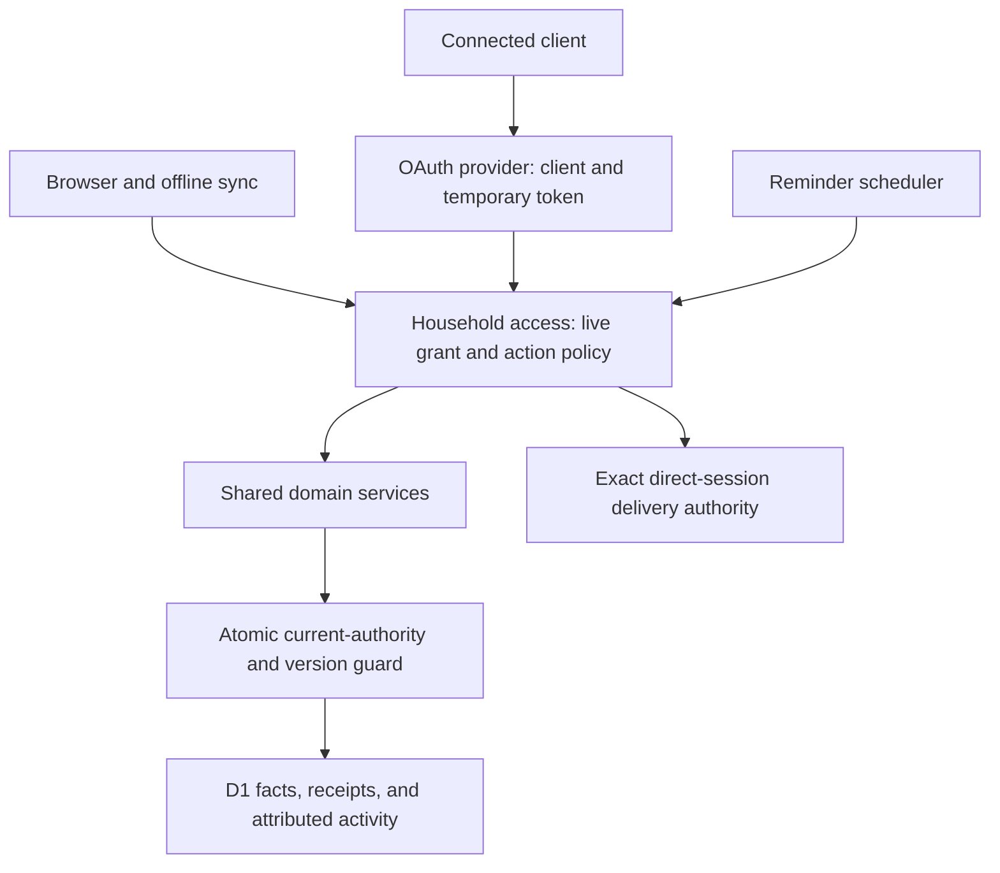
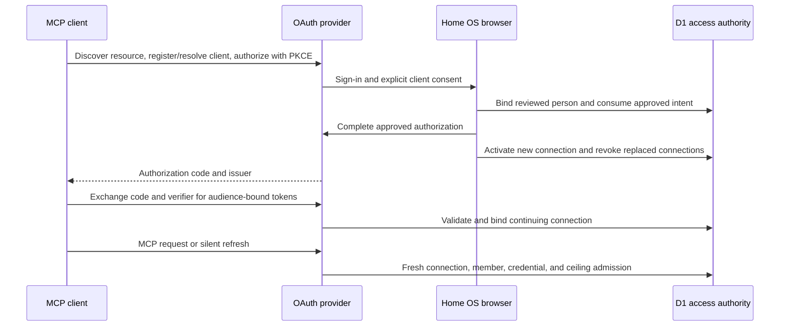
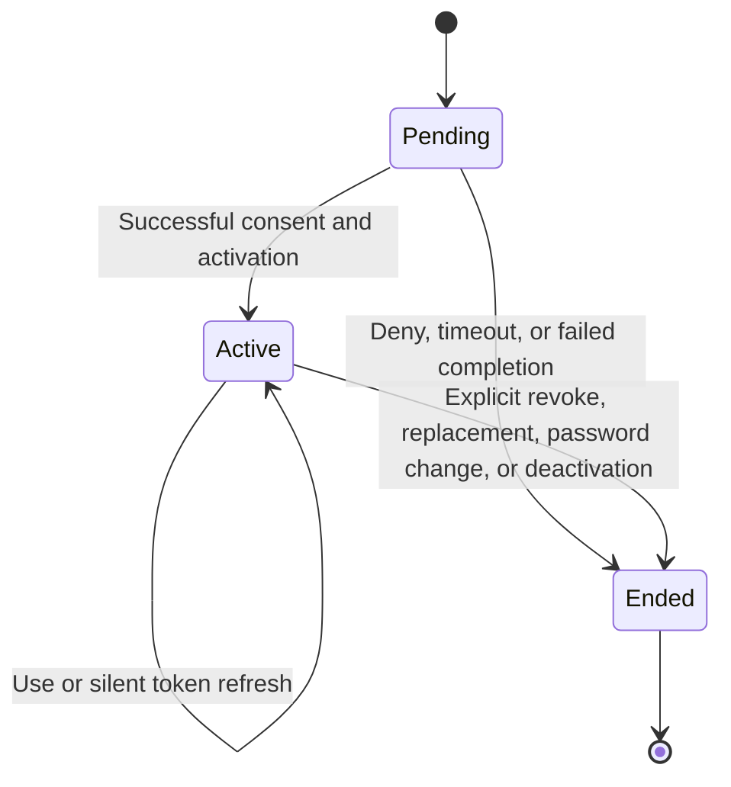
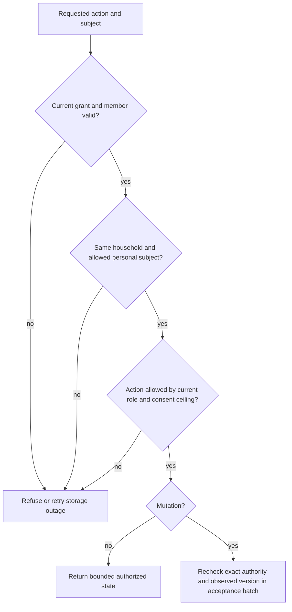
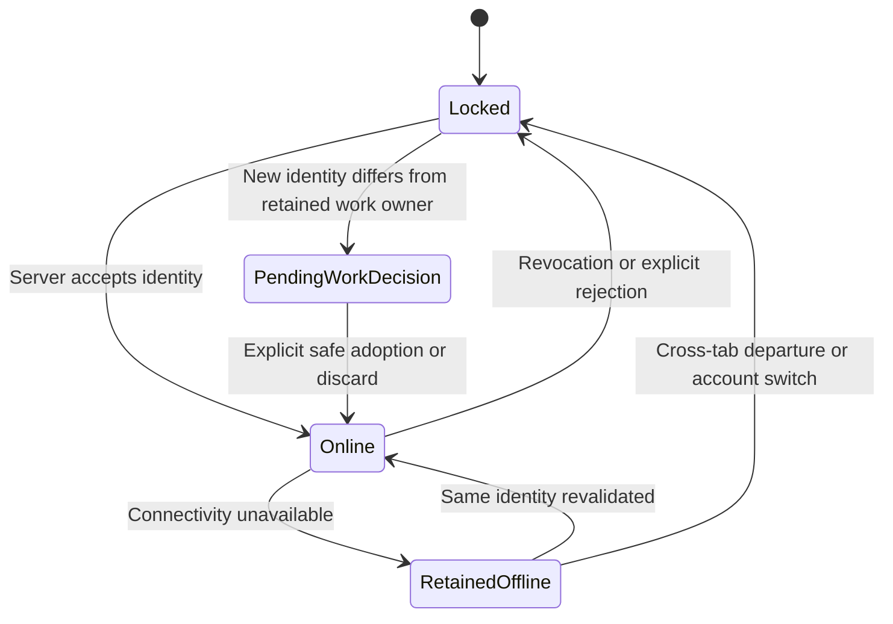
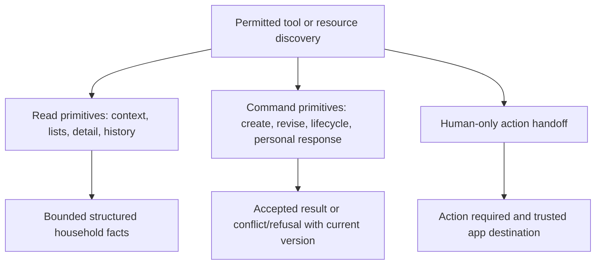

# User MCP and Persistent Access - Plan

## Goal Capsule

- **Objective:** Every household user can connect an assistant to perform their permitted Home OS work and stay signed in until they or an owner end that access.
- **Means:** Reuse one household action policy, add personal OAuth connections, and remove automatic continuing-grant deadlines (KTD1-KTD4).
- **Authority:** The user request governs product scope; the Product Contract governs behavior; Designer-owned subsystem contracts govern structure; the Planning Contract governs implementation choices.
- **Execution profile:** Implement all units, verify the behavior, and resolve routine implementation details without further check-ins.
- **Tail ownership:** The invoking shipping workflow owns simplification, independent review, CI, merge into main, production migration/deployment, live verification at `https://home.dhruvverma.dev`, and landed-worktree cleanup.
- **Stop conditions:** Surface a proven contradiction with these contracts or missing production authority. Never substitute a permissive fallback when authority cannot be verified.

---

## Product Contract

### Summary

Give every active Owner, Member, and Viewer a personal MCP connection with explicit consent and revocation.
Use the same role permissions and durable household facts in the app and connected assistants.
Keep browser sign-in and delegated grants valid without an automatic server deadline, while retaining effective logout, password replacement, and owner revocation.

### Problem Frame

The existing MCP endpoint uses one operator bearer secret and exposes only inventory and activity reads.
It cannot attribute ordinary household actions to individual people or give each person control over connected assistants.
Browser access currently expires after twelve hours or thirty days, which interrupts the household's expected persistent sign-in.

### Actors

- A1. Owner: maintains household facts and membership, and can revoke household access.
- A2. Member: maintains household facts, answers their own meal attendance, and controls their personal reminders and connections.
- A3. Viewer: reads shared facts and controls their own reminders and connections.
- A4. Connected client: acts for one consenting person within that connection's approved ceiling.
- A5. Browser/device and reminder scheduler: retain direct access and deliver notifications only while their exact authority remains valid.

### Requirements

**Roles and shared authority**

- R1. Retain only Owner, Member, and Viewer roles with one action policy applied to HTTP, offline sync, MCP discovery, resources, and tool execution.
- R2. Effective connected authority is the intersection of the current active member role, the connection's explicitly approved role ceiling, the household, and ownership of the requested personal subject.
- R3. Owners alone maintain membership/access; owners and members maintain shared domain facts and answer attendance for themselves; viewers inspect shared facts and cannot answer attendance.
- R4. Every active person may inspect/revoke their own connections and manage their own reminder preferences/read state; owners may inspect non-secret household connection status and revoke another member's connection.
- R5. Admission remains valid when a mutation is accepted, including retries and offline sync; intervening grant revocation, credential replacement, deactivation, or demotion cannot be bypassed by an earlier check or a stored receipt.

**Personal MCP connections**

- R6. Each active account can connect compatible MCP clients through explicit browser consent showing the client, destination, resource, and role-bound capabilities.
- R7. Connections expose all ordinary domain actions in the coverage ledger below using the existing household authorities and durable objects.
- R8. Account creation, password entry/replacement, OAuth consent, and native browser push permission/enrollment remain direct personal interactions; MCP returns a truthful `requires_user_action` handoff instead of claiming completion.
- R9. Connected commands use authenticated actor attribution, operation identity, and observed domain versions; results distinguish accepted changes, conflicts, refusals, and interactive handoffs.
- R10. Promotion does not broaden an existing connection's approved ceiling; a fresh consent is required for broader capabilities, while demotion limits subsequent actions immediately.
- R11. A person can inspect and revoke their browser sessions and connected clients; revoking one grant does not silently revoke unrelated grants.

**Continuing access and revocation**

- R12. New browser sessions and currently valid existing browser sessions gain no automatic server deadline; expired or revoked historical grants never become valid again.
- R13. The app persists non-secret identity/session state across reopen and renews the browser cookie during use; it explains that browser storage clearing, device policy, or browser cookie retention can still require login.
- R14. OAuth access tokens are temporary, and a valid indefinitely continuing refresh grant renews access silently until revoked.
- R15. Sign-out ends the initiating browser grant and its notification-device authority, while separately consented MCP connections remain valid.
- R16. Successful password replacement/reset and member deactivation invalidate all that member's pre-change browser and MCP grants; reactivation restores no old grant.
- R17. A valid device session has no artificial delivery deadline, but native push subscription expiry and fresh meal/member/preference authority remain independently enforceable.
- R18. Retained offline inventory and household copies stay within the existing member boundary; no cached session becomes fresh server authority, and explicit server rejection cannot be undone by offline fallback.

**Release and compatibility**

- R19. Retire attribution-free operator bearer acceptance and explain that existing clients must reconnect personally at the canonical custom-domain MCP URL.
- R20. The release preserves inventory, expense-rule, recipe/menu/attendance, contacts, PWA, and reminder behavior, and completes reviewed implementation, green CI, merge, deployment, and live verification.

### Key Flows

- F1. A client discovers authorization, opens Home OS, the person signs in if needed, reviews the client and role-bound capabilities, approves, and the client receives its own tokens. Covers R2, R6, R10, R14.
- F2. A connected client reads current versions, submits one domain command, and sees the accepted durable result or a recoverable conflict. The PWA sees the same accepted state and activity actor. Covers R5, R7, R9.
- F3. A person reopens Home OS, including offline, and continues within their retained member boundary; online rejection locks the view without discarding unrelated pending inventory intent. Covers R12-R13, R18.
- F4. A person or owner revokes a connection/session; subsequent requests, refreshes, replays, and device delivery fail the revoked authority check. Covers R5, R11, R15-R17.
- F5. An assistant requests a password or device enrollment action and receives a safe app destination; the person completes it interactively under current authority. Covers R8.

### Acceptance Examples

- AE1. A Viewer authorizes a client, reads tomorrow's menu and contacts, marks their own reminder read, and is refused a recipe edit, another person's inbox, and meal attendance. Covers R1-R4, R6-R7.
- AE2. A connected Member becomes Owner. Their existing connection cannot edit membership until re-consent; after demotion no connection can retain owner authority. Covers R2, R10.
- AE3. A valid old browser row becomes permanent, an expired old row stays invalid, and neither grant is represented by an invented far-future timestamp. Covers R12.
- AE4. A command waits after admission, then its exact session/connection is revoked. Its mutation, receipt, and audit batch do not commit, and replay cannot disclose a previous result. Covers R5, R9.
- AE5. A browser signs out. Its push authority ends and its cached member boundary locks, while a separately approved MCP client continues. A later password reset ends both old browser and MCP authority. Covers R15-R18.
- AE6. A client refreshes after access-token expiry without another login, then cannot refresh or call a tool after its connection is revoked. A storage outage produces a retryable failure without revoking a healthy grant. Covers R11, R14.
- AE7. A consent page is opened by one person, the browser switches accounts, and approval refuses the stale reviewed intent rather than authorizing the new person. Covers R2, R6.
- AE8. An assistant's password-reset or push-enrollment handoff reports action required and contains no password field, receiving key, session hash, or successful-completion claim. Covers R8-R9.

### Scope Boundaries

The work extends the existing single-household app and its current domain model.
It does not add custom roles, a permission editor, a payments ledger, automatic pantry consumption, public signup, production seed users, or paid identity infrastructure.
Protocol token exchange is not a household tool and reusable access credentials never enter household results or activity.

---

## Planning Contract

### Assumptions

- The user wants persistent direct sign-in by default, so the old remember-duration choice is removed rather than retaining a second expiring mode.
- A single role-bound OAuth permission is sufficient; clients do not need an additional read-versus-manage preference screen for this release.
- Connection and browser-session labels use non-secret client/device descriptions, creation/last-seen information, and a current-session marker; no IP address collection is needed.

### Key Technical Decisions

- KTD1. **One action policy and one authority reference.** Add a typed action catalogue and transport-neutral verified authority context under `apps/worker/src/auth/`; retain browser and MCP grant variants behind the same policy. The authority reference is a discriminated browser proof (exact session hash and credential generation) or delegated proof (connection ID, credential generation, and approved ceiling), constructed only by trusted admission. All domain mutation batches include a current actor/credential/grant/ceiling guard. Extract member business behavior from `http/member-routes.ts` so owner commands do not require an internal browser request. Implements R1-R5, R9; follows the existing atomic owner admission and `platform/household-command.ts` transaction pattern.
- KTD2. **Additive permanent-session policy.** Add an explicit session policy flag, defaulting to legacy expiry enforcement, and mark only sessions valid at migration time permanent, requiring unexpired time, active same-household membership, and current credential generation. New permanent rows retain the creation-time expiry-column value solely as legacy metadata, not an admission deadline; public `expiresAt` is null and the permanent flag is the authority. Never substitute a year-2099 sentinel or rebuild the referenced session table. This preserves notification child foreign keys and implements R12, R17.
- KTD3. **Official one-Worker OAuth provider.** Pin `@cloudflare/workers-oauth-provider` 1.2.4, use an `OAUTH_KV` binding, and upgrade `@modelcontextprotocol/server` compatibly from 2.0.0 to 2.4.0. Adopt the [current MCP authorization contract](https://modelcontextprotocol.io/specification/2026-07-28/basic/authorization) through the [Cloudflare provider](https://github.com/cloudflare/workers-oauth-provider) rather than implementing tokens, PKCE, or consent signing. Serve the canonical resource `https://home.dhruvverma.dev/mcp`, authorization metadata, RFC9728 challenge, PKCE S256, audience-bound tokens, issuer binding, preferred CIMD, and DCR compatibility. Enable `global_fetch_strictly_public` for CIMD fetches. Gate OAuth, metadata, and MCP requests to the trusted canonical origin because the combined provider derives issuer from the request URL; reject alternate-origin OAuth while preserving ordinary app/health behavior. Explicit local-test origin configuration is separate from production and never inferred from Host. Implements R6, R14, R19.
- KTD4. **Durable D1 connection admission with temporary access tokens.** Use one supported scope `home:access` and snapshot the reviewed role as the consent ceiling. Configure access lifetime to fifteen minutes, explicitly unset provider refresh-token and client-registration TTLs, and leave idle expiry unset. An application connection record is authoritative on every MCP request and refresh; KV token presence alone is insufficient. Bind connection ID, member/household, credential generation, provider client and grant identifiers, status, and approved ceiling without storing raw tokens. Permanent revocation returns `invalid_grant`; transient authority-storage failure is retryable and must not revoke the connection. Implements R2, R10-R11, R14-R16.
- KTD5. **Provider consent primitives plus a bounded app intent.** Use the published provider's describe/begin/approve/deny consent helpers, including every returned binding and anti-framing header. A short-lived opaque app intent supplies the SPA preview/login return and records the exact reviewed member/client/resource/redirect/capability ceiling; approval consumes both the intent and provider handle. A role change since preview invalidates that preview and requires redisplaying current capabilities before approval. Pending intents expire and are pruned. Anonymous DCR and intent creation have bounded admission before persistent writes, using the provider registration callback and existing Worker admission patterns; failed anonymous attempts and limiter-key cardinality have bounded retention. No identity is inferred from a client-supplied actor. Implements R6, R8 and AE7.
- KTD6. **Fail closed across D1 and KV.** Create a pending application connection before completing provider authorization, then atomically activate it and revoke prior active same-member/client/resource rows before returning the client redirect. Pending or failed rows admit nothing. Capture the provider grant ID from the token-exchange callback because complete-authorization returns only a redirect URL; the callback binds it with compare-and-set to the active connection, accepting an unset ID or the same already-bound ID and refusing a different provider grant ID. Revoke replacement rows in D1 even when the provider also revokes its old grants, so cached tokens cannot retain authority. Accepted revocation is recorded in D1 before best-effort provider cleanup, which is retryable. Implements R5, R11, R14 and prevents phantom/replaced grants.
- KTD7. **Nullable session deadline and renewable browser retention.** Update server/web session DTOs and deadline helpers together. Persistent HttpOnly, Secure, SameSite=Strict cookies use the browser's 400-day maximum and renew on authenticated use without writing D1 on every request. Non-secret saved-session v1 snapshots are read compatibly: valid legacy snapshots may reopen offline, expired legacy snapshots remain invalid, and only a server-validated permanent response becomes a null-deadline snapshot. Preserve data-owner keys, cross-tab leases, pending-work prompts, and explicit-rejection locking. Implements R12-R13, R18; the browser limitation is explained beside persistent access controls.
- KTD8. **Primitive domain tools and safe interactive handoffs.** Tools call shared application services, never internal HTTP routes or a parallel datastore. Mutation schemas accept operation ID and the domain's observed version, but no selected actor, role, household, or credential. Reuse domain validation and canonical errors, return rich accepted state and recoverable conflict details, and annotate tools accurately. Human-only actions return `requires_user_action` with an action label and an allowlisted same-origin destination; no arbitrary redirect or secret input is accepted. Fixed destinations are `/?view=account&action=password`, `/?view=members&action=create-member`, `/?view=members&action=reset-password&member=<public-member-id>`, and `/?view=notifications&action=enable`; the member ID is validated and never supplies authority. OAuth review uses `/?view=account&connect=<opaque-intent-id>`. Opening any destination only opens the relevant form or consent view and cannot execute a mutation or native permission request. Implements R7-R9.
- KTD9. **Bounded reads and exports.** Give MCP lists/history/export an explicit cursor, limit, and continuation contract. Batch inventory enrichment over a bounded page instead of per-item unbounded queries, and page export histories rather than calling the existing full HTTP export. The legacy inventory resource remains available with a truthful bounded page/continuation response and additional context/resources are authorized identically. Every invocation stays within the D1 Free fifty-request bound, including admission and failed paths. Implements R7, R20.
- KTD10. **Explicit retirement of the operator secret.** Remove the `HOMEOS_MCP_TOKEN` acceptance path and its required configuration/documentation. A retained deployment secret may remain unused for rollback; it cannot authorize any request. Existing four tool names and inventory resource URI remain where semantically compatible, but every caller reconnects through personal authorization. Implements R19.

- KTD11. **Expose only authoritative revocation.** The pinned provider has no public revocation callback linking its optional RFC7009 path to D1. Remove only revocation metadata from its generated discovery response while preserving other metadata and headers, and reject that optional token-body request before the provider handles it. Reject JSON and other unsupported token content types, matching published 1.2.4; classify only bounded form-urlencoded bodies as the provider does: a truthy top-level token without a grant type, never a substring match against subject-token exchanges. App and MCP connection-revoke commands remain the supported immediate D1 authority boundary. RFC7009 is an [OAuth2.1 extension](https://www.ietf.org/ietf-ftp/internet-drafts/draft-ietf-oauth-v2-1-17.html#appendix-D), not a required MCP authorization feature; documentation must state the available revoke controls without claiming protocol revocation support. Implements R11,R14; avoids token-verification duplication and phantom active grants.

### High-Level Technical Design

**Authority and data flow**

**Connection protocol**

**Continuing-grant lifecycle**

**Permission decision**

**Browser/offline states**

**Action surface and outcome shape**

### Action Policy and Coverage Ledger

`O` = Owner, `M` = Member, `V` = Viewer. Each permission is further restricted by R2.
All HTTP paths below start with `/api/v1` unless stated otherwise.
The ledger owns the required operation coverage; names may be grouped into small tool modules without omitting actions.

| Capability and policy action | HTTP/app surface | MCP tools/resource | Roles/subject | Coverage units |
|---|---|---|---|---|
| Current identity and permitted actions | Current auth status/app shell | `home_context` | O/M/V, self; household timezone and versions | U1,U5 |
| Inventory list/search/filter/attention | GET `/items`, shopping view | Existing `inventory_list`, `inventory_attention`; catalog resource | O/M/V | U4 |
| Item detail/history | GET `/items/:id`, `/items/:id/events` | Existing `inventory_get`, `inventory_events` | O/M/V | U4 |
| Inventory create/edit | POST `/items`, PATCH `/items/:id`, sync equivalents | `inventory_create`, `inventory_update` | O/M | U1,U4 |
| Consume/restock/mark level | POST `/items/:id/events`, sync equivalents | `inventory_stock` with existing event type | O/M | U1,U4 |
| Inventory archive/restore | DELETE `/items/:id`, POST `/items/:id/restore`, sync | `inventory_archive`, `inventory_restore` | O/M | U1,U4 |
| Export inventory and history | GET `/export` | `inventory_export` with cursor/continuation | O/M/V | U4 |
| Activity and item activity | GET `/activity`, `/items/:id/activity` | Existing `activity_list`, filter by entity | O/M/V | U4 |
| Expense rule list/detail | GET `/expenses`, `/expenses/:id` | `expenses_list`, `expenses_get` | O/M/V | U4 |
| Expense rule create/edit/archive/restore | POST `/expenses`, PATCH/DELETE `/expenses/:id`, POST restore | `expenses_create`, `expenses_update`, `expenses_archive`, `expenses_restore` | O/M | U1,U4 |
| Recipe list/detail and availability | GET `/recipes`, `/recipes/:id` | `recipes_list`, `recipes_get` | O/M/V | U5 |
| Recipe create/edit/archive/restore | POST `/recipes`, PATCH/DELETE `/recipes/:id`, POST restore | `recipes_create`, `recipes_update`, `recipes_archive`, `recipes_restore` | O/M | U1,U5 |
| Menu range and meal detail | GET `/meals?from&to`, `/meals/:id` | `meals_list`, `meals_get` | O/M/V; explicit household-local date range | U5 |
| Meal create/edit/cancel | POST `/meals`, PATCH `/meals/:id` | `meals_create`, `meals_update`, `meals_cancel` | O/M | U1,U5 |
| Own attendance yes/no/unanswered | PUT `/meals/:id/attendance` | `meal_attendance_set` | O/M, implicit self; announcement/response versions | U1,U5 |
| Contacts list/detail | GET `/contacts`, `/contacts/:id` | `contacts_list`, `contacts_get` | O/M/V | U5 |
| Contacts create/edit/archive/restore | POST `/contacts`, PATCH/DELETE `/contacts/:id`, POST restore | `contacts_create`, `contacts_update`, `contacts_archive`, `contacts_restore` | O/M | U1,U5 |
| Personal inbox/read state | GET `/notifications`, PATCH `/notifications/:id` | `notifications_list`, `notifications_mark_read` | O/M/V, self | U1,U5 |
| Personal reminder preferences/status | GET/PUT `/notifications/preferences` | `notification_preferences_get`, `notification_preferences_set` | O/M/V, self; no endpoint/key disclosure | U1,U5 |
| Browser push config/enroll/retire/delivery check | `/notifications/config`, `/subscriptions/current`, `/:id/delivery-check` | `notification_device_setup` handoff | O/M/V, direct exact browser device only | U2,U5,U6 |
| Member roster | GET `/members` | `members_list` | O/M/V, household-safe roster | U1,U5 |
| Member profile/role/active-state edits | PATCH `/members/:id` | `members_update` | O; last-owner and current authority guarded | U1,U5 |
| Account creation/password setup/reset | POST `/members`, `/members/:id/password` | `member_access_setup` / `member_password_reset` handoffs | O; trusted app target rechecks current authority | U5,U6 |
| Own password replacement | POST `/auth/password` | `account_password_change` handoff | O/M/V, direct self | U2,U5,U6 |
| List/revoke MCP connections | New `/auth/connections` read/revoke endpoints | `connections_list`, `connections_revoke` | Self; O may select household member | U3,U5,U6 |
| List/revoke browser sessions | New `/auth/sessions` read/revoke endpoints | `sessions_list`, `sessions_revoke` | Self; O may revoke household access | U2,U5,U6 |
| Browser login/setup/sign-out | Existing `/auth/setup`, `/auth/login`, `/auth/logout` | Safe login/app handoff; no password tool | Direct browser proof only | U2,U6 |
| OAuth discovery/register/authorize/token/revoke | Provider metadata and OAuth endpoints; browser consent; optional RFC7009 omitted/rejected per KTD11 | Protocol, never ordinary household tools | Every active account may consent; token client/resource bound | U3,U6,U7 |

MCP does not need a duplicate offline-sync command: primitive inventory operations use the same authority/services and operation semantics as `/sync`.
Native push config/delivery-check do not acquire token-based alternatives because their purpose is exact browser-device authority.

### System-Wide Impact and Risks

- **Migration and delivery:** KTD2 preserves the session parent table and its subscription/delivery cascades. All session admission, cleanup, owner admission, notification registration/pruning, and scheduler freshness checks must use the same permanent-aware predicate.
- **Mutation/replay races:** KTD1 reaches inventory, expenses, meals, contacts, membership, personal notification writes, connections, sessions, and sync. Authority failure rolls back facts, receipts, and audit together; fresh authority precedes receipt disclosure.
- **Credential races:** Retain compare-and-set credential generations and revoke only pre-change grants. A losing stale password attempt must not invalidate the winner's newly issued session/connection.
- **OAuth consistency:** KTD6 makes partial KV/D1 writes unusable rather than optimistic. Repeated approval and revoke requests are idempotent; stale pending intents and failed connection rows have bounded cleanup.
- **Request budgets:** KTD9 includes error paths and authorization overhead. Preserve the notification scheduler's existing bounded fanout, native expiry, retry, and eligibility rules.
- **Browser privacy:** Connection summaries, session summaries, tool results, audit, and logs exclude reusable tokens, hashes, passwords/verifiers, push endpoints, and receiving keys. No-store applies to access/consent/account responses; these routes and OAuth metadata must reach the Worker before static asset fallback.
- **Release ordering:** Apply additive migrations before deploying code that reads the new fields; provision KV and asset-routing flags first. A code rollback may restore expiry behavior for new permanent rows because their legacy expiry field is historical metadata; rollback requires an explicit access policy decision and must never reset it to a misleading future date.

### Sources and Resolved Constraints

Designer materialized the affected auth/MCP/domain/web contracts and reported READY with eleven contracts, forty-two paired meanings, eleven environmental inputs, and nine environmental outputs validated.
Implementation binds to `apps/worker/src/auth/SUBSYSTEM.md`, `apps/worker/src/mcp/SUBSYSTEM.md`, all affected domain contracts, and `apps/web/src/auth/SUBSYSTEM.md`.
The earlier meals plan's expiry-dependent delivery language is superseded only by R12 and R17 here; its other domain and device-security constraints remain.

Browser retention follows the [Chrome cookie maximum and renewal guidance](https://developer.chrome.com/blog/cookie-max-age-expires).
Primary version/API evidence is the published provider 1.2.4 declaration surface, [official provider authorization documentation](https://github.com/cloudflare/workers-oauth-provider/blob/main/docs/authorization-server.md), [Cloudflare MCP authorization guidance](https://developers.cloudflare.com/agents/model-context-protocol/protocol/authorization/), and the MCP specification linked in KTD3.
Provider helper return shapes and explicit unset TTL behavior are load-bearing; U3 verifies the installed 1.2.4 runtime and published declarations rather than treating repository-main documentation as the pinned implementation. In particular, the published token endpoint accepts form-urlencoded only.
No strategy, concepts, institutional solution corpus, or declared Compound Packs exists in this checkout.

---

## Implementation Units

### U1. Shared policy and atomic action admission

**Goal:** Make current household authority identical across HTTP, sync, and connected commands.

**Requirements:** R1-R5, R9; F2,F4; AE1,AE2,AE4.

**Dependencies:** Designer READY contracts, already materialized.

**Files:** `apps/worker/src/auth/permissions.ts` (new), `apps/worker/src/auth/authority.ts` (new), `apps/worker/src/auth/members.ts` (new), `apps/worker/src/platform/context.ts`, `apps/worker/src/platform/household-command.ts`, `apps/worker/src/http/request-context.ts`, `apps/worker/src/http/member-routes.ts`, `apps/worker/src/auth/session.ts`, `apps/worker/src/auth/routes.ts`, `apps/worker/src/auth/support.ts`, `apps/worker/src/notifications/routes.ts`, `apps/worker/src/inventory/service.ts`, `apps/worker/src/inventory/repository.ts`, `apps/worker/src/inventory/d1-repository.ts`, `apps/worker/src/expenses/catalog/service.ts`, `apps/worker/src/expenses/catalog/repository.ts`, `apps/worker/src/expenses/catalog/d1-repository.ts`, `apps/worker/src/meals/d1-repository.ts`, `apps/worker/src/contacts/d1-repository.ts`, `apps/worker/src/notifications/d1-repository.ts`, `apps/worker/src/sync/routes.ts`, `apps/web/src/offline/sync.ts`; tests `apps/worker/test/permissions.test.ts` (new), `apps/worker/test/member-authority.test.ts`, `apps/worker/test/member-access-concurrency.test.ts`, `apps/worker/test/sync.test.ts`.

**Approach:**

1. Define the ledger actions once and return capabilities from the verified role/ceiling/subject policy; replace transport-specific blanket viewer/method decisions. U1 implements browser admission against the existing schema and defines the delegated proof contract; it must not query future connection tables. U3 supplies delegated resolution after its migration, and U2 upgrades the browser predicate after its migration.
2. Extend command context with KTD1's exact verified grant reference. Revalidate it in each mutation acceptance batch and before replay disclosure, including personal notification writes, consent issuance, and connection/session revokes.
3. Extract the existing member/account commands and their transactional owner admission, uniqueness, last-owner trigger handling, and audit semantics into transport-neutral behavior. Preserve conditional accepted-password-hash updates and credential race protection; make audit support preserve MCP client/tool/source rather than hardcoding PWA.
4. Fingerprint stable caller intent before generated IDs or timestamps. Reuse household command receipts for inventory/expense/member actor-plus-payload binding; its entity-type column has no database CHECK, so no new schema is needed. Legacy processed-operation receipts lacking actor/hash require traceable same-intent authority or a safe conflict, never blind success. Batch catch/replay paths must recheck authority and cannot turn a failed authorization guard into replay success or an entity-version conflict.
5. Characterize sync binding cost after admission changes; cap server batches and chunk the browser inventory queue to the proven safe size while retaining operation identities and reconnect recovery.

**Patterns to follow:** Existing ownerMutationAdmission, credential compare-and-set, mutation_guards batches, and household command receipts.

**Execution note:** Characterize the existing role and revocation races before replacing admission paths.

**Test scenarios:**

- Covers AE1. Table-drive every ledger action for O/M/V, own/other subject, and mismatched household; HTTP and MCP use the same verdict.
- Covers AE2. A saved member ceiling refuses owner actions after promotion; current viewer role refuses shared writes even under an old owner ceiling.
- Covers AE4. Revoke/deactivate/demote the actor between service entry and batch acceptance for inventory, expenses, meals, contacts, member changes, personal writes, and sync; no fact/receipt/audit commits.
- Replay a completed operation after exact grant revocation; refuse before returning stored domain state, including batch-error catch/replay branches.
- Sync a queue larger than one safe request page; the browser resumes bounded chunks without loss/duplicate acceptance and each invocation stays within fifty binding requests.
- Reuse an operation ID with another actor or changed payload/version; return a conflict rather than another actor's result.
- Preserve final-owner protection, latest-email password setup, duplicate-email conflicts, and delayed profile edits that cannot reactivate a member.

**Verification:** All transports use ledger actions and shared services; transaction and replay regression evidence proves current authority rather than relying on a request-entry mock.

### U2. Permanent browser grants and device authority

**Goal:** Remove browser/session deadlines while preserving expired-history and device revocation semantics.

**Requirements:** R11-R13,R15-R18; F3,F4; AE3,AE5.

**Dependencies:** U1.

**Files:** `apps/worker/migrations/0008_continuing_access.sql` (new, additive), `apps/worker/src/auth/session.ts`, `apps/worker/src/auth/routes.ts`, `apps/worker/src/auth/members.ts`, `apps/worker/src/notifications/model.ts`, `apps/worker/src/notifications/d1-repository.ts`, `apps/worker/src/notifications/scheduled.ts`, `apps/web/src/lib/auth.ts`, `apps/web/src/auth/session.ts`, `apps/web/src/auth/auth-gate.tsx`, `apps/web/src/auth/work.ts`, `apps/web/src/components/auth-screen.tsx`; tests `apps/worker/test/auth.test.ts`, `apps/worker/test/auth-device-grants.test.ts`, `apps/worker/test/password-race.test.ts`, `apps/worker/test/household-storage.test.ts`, `apps/worker/test/notification-scheduler.test.ts`, `apps/web/src/auth/session.test.ts`, `apps/web/src/auth/auth-gate.test.tsx`, `apps/web/src/auth/work.test.ts`, `apps/web/src/components/service-worker.test.ts`.

**Approach:**

1. Apply KTD2 and use one permanent-aware predicate in admission, cleanup, transaction guards, notification registration/pruning, and scheduler checks.
2. Introduce the nullable public deadline and persistent cookie/storage behavior in KTD7 together, removing automatic-expiry timers for permanent sessions.
3. Add safe session list/revoke services and routes, with opaque public session IDs distinct from token hashes, a current marker, and immediate own-session lock after accepted revoke.
4. Centralize pre-change grant revocation on successful credential replacement/deactivation; preserve native endpoint expiry independently.

**Test scenarios:**

- Covers AE3. Migrate valid, expired, and exact-boundary legacy rows with subscription/delivery children; only fully valid rows become permanent and child identities survive. Include unexpired rows with stale credentials or inactive members; neither is backfilled or later resurrected.
- Advance trusted time beyond former twelve-hour/thirty-day deadlines; permanent auth and notification authority remain valid, while legacy expired grants and native expired subscriptions fail.
- Covers AE5. Sign out or revoke an exact session and observe cascade/device suppression without revoking another session or MCP connection.
- Race password changes/reset against one another; only the winning credential transition revokes older generations and no losing attempt revokes a newer grant.
- Reopen a permanent saved identity offline, preserve same-member pending work, reject expired v1 snapshots, and never restore explicitly rejected state through offline fallback.
- Verify 400-day cookie renewal and secure attributes, null DTO validation, malformed storage rejection, cross-tab locking, and account-switch discard/adoption behavior.

**Verification:** Migration fixtures preserve foreign-key chains; server, web, scheduler, and service-worker authority agree on permanent versus revoked state.

### U3. OAuth authorization, consent, and connection lifecycle

**Goal:** Give every active account revocable personal MCP authorization using the official provider.

**Requirements:** R2,R4,R6,R10-R11,R14-R16,R19; F1,F4; AE2,AE6,AE7.

**Dependencies:** U1,U2.

**Files:** `apps/worker/src/auth/oauth.ts` (new), `apps/worker/src/auth/connections.ts` (new), `apps/worker/src/auth/consent.ts` (new), `apps/worker/src/auth/handoffs.ts` (new), `apps/worker/src/auth/routes.ts`, `apps/worker/src/mcp/routes.ts`, `apps/worker/src/index.ts`, `apps/worker/src/env.ts`, `apps/worker/wrangler.jsonc`, `apps/worker/package.json`, `package-lock.json`, `apps/worker/migrations/0009_mcp_connections.sql` (new); tests `apps/worker/test/oauth.test.ts` (new), `apps/worker/test/mcp-connections.test.ts` (new), `apps/worker/test/auth-device-grants.test.ts`.

**Approach:**

1. Wrap the existing app with KTD3's single-Worker provider, preserving the scheduled handler and all existing HTTP/static responses. Route OAuth and metadata paths before assets, and normalize the optional revocation feature under KTD11.
2. Implement KTD4-KTD6 using D1 connection/intent tables, provider consent helpers, and provider token-exchange callbacks. Fail closed on incomplete activation and distinguish revocation from temporary storage failure.
3. Add self/owner-safe connection listing/revoke services, replacement reconciliation, and bounded cleanup/retry of pending intents and provider cleanup work. Publish the fixed handoff destination helper from KTD8 here so U6 can implement its web contract independently of tool registration.
4. Remove operator-token acceptance under KTD10. Enforce KTD3's canonical-origin gate before the provider; trusted endpoint strings alone cannot prevent an alternate issuer.

**Test scenarios:**

- Covers AE6. Real provider code/PKCE exchange obtains a short-lived resource-bound token and an indefinitely refreshing grant; revoke rejects access and refresh immediately through D1.
- Verify RFC9728 challenge/metadata, authorization-server discovery, issuer/resource enforcement, CIMD and DCR, registered redirects, S256-only PKCE, unknown scopes, missing consent, and another client's code/token rejection.
- Covers AE7. Consent replay, expired handles/intents, cross-origin approval, switched member, role change between preview and approval, and changed approval payload cannot authorize access; deny returns the provider's validated error redirect.
- Covers AE2. Token refresh never upgrades the consent ceiling; demotion applies immediately and inactive/credential-replaced members cannot refresh.
- Concurrent code-exchange/retry can bind an unset provider grant ID once or reuse the same ID, but a different grant cannot attach to the connection.
- Simulate failure before and after provider grant creation, D1 activation, provider grant-ID binding, and revoke cleanup; pending or replaced rows never authorize and retries do not leave permanently pending records.
- Verify outage returns retryable protocol failure without marking a healthy connection revoked; raw tokens/hashes/receiving secrets never appear in records intended for clients or logs.
- Existing operator bearer, wrong-resource tokens, alternate workers.dev/Host-derived OAuth issuer attempts, and unapproved clients receive no household authority; ordinary health/app behavior still works.
- Repeated anonymous registration/intent creation is rejected before the configured write budget, key/intent retention remains bounded, and legitimate CIMD/DCR personal onboarding succeeds.
- Discovery omits optional protocol-revocation metadata but preserves other fields/headers; JSON/unsupported token content types and bounded form revocation bodies are rejected, while valid form code/refresh and RFC8693 subject-token exchange requests are not misclassified. App/MCP revoke ends the D1 connection immediately.

**Verification:** OAuth behavior is exercised through the actual pinned provider in Worker/KV integration tests, including refresh options and consent cookies; unit mocks alone are insufficient.

### U4. Inventory, activity, and expense-rule MCP parity

**Goal:** Let connected users perform permitted stock and recurring-rule work with bounded reads and shared semantics.

**Requirements:** R1-R2,R5,R7,R9,R19-R20; F2; AE4.

**Dependencies:** U1,U3.

**Files:** `apps/worker/src/mcp/server.ts`, `apps/worker/src/mcp/inventory-tools.ts` (new), `apps/worker/src/mcp/expense-tools.ts` (new), `apps/worker/src/mcp/results.ts` (new), `apps/worker/src/inventory/validation.ts` (new), `apps/worker/src/expenses/catalog/validation.ts` (new), `apps/worker/src/inventory/service.ts`, `apps/worker/src/inventory/d1-repository.ts`, `apps/worker/src/http/inventory-routes.ts`, `apps/worker/src/http/expense-routes.ts`; tests `apps/worker/test/mcp.test.ts`, `apps/worker/test/mcp-domain-parity.test.ts` (new), `apps/worker/test/inventory-api.test.ts`, `apps/worker/test/expense-api.test.ts`, `apps/worker/test/d1-budget.ts`.

**Approach:**

1. Register ledger primitives through shared schemas/services and verified context; retain existing public tool names where their semantics remain accurate.
2. Apply KTD9 to stock list/history/attention/catalog/export, including correct restock cadence and forecast meaning across page boundaries.
3. Return canonical structured accepted state, conflicts, validation failures, and accurate tool annotations; record MCP client/tool provenance without secret proof.

**Test scenarios:**

- Create/edit/stock/archive/restore inventory through MCP and read identical PWA/API state and attributed activity; simple/exact stock and declared restock cadence behave identically.
- Create/edit/archive/restore expense rules through MCP and observe existing cadence, minor-unit, split, inactive-participant, and version-conflict behavior.
- Repeat a timed-out command's operation ID and obtain one accepted change; changed payload/actor cannot reuse it.
- Page inventory/history/export over more than fifty items and verify complete continuation without loss/duplication, correct attention filtering, and at most fifty binding requests per invocation.
- Refuse viewer writes, wrong-household subjects, revoked requests, untrusted actor fields, and stale versions without committing activity.
- Inspect catalog and tool results for account proof, token/hash, and push receiving-secret leakage.

**Verification:** Every U4 ledger row has HTTP/MCP outcome parity and measured Worker binding-budget coverage.

### U5. Cooking, contacts, personal state, and owner MCP parity

**Goal:** Complete the connected household action surface and honest interactive boundaries.

**Requirements:** R1-R11; F2,F4,F5; AE1,AE2,AE8.

**Dependencies:** U1,U2,U3,U4 shared result/context conventions.

**Files:** `apps/worker/src/mcp/household-tools.ts` (new), `apps/worker/src/mcp/access-tools.ts` (new), `apps/worker/src/mcp/server.ts`, `apps/worker/src/notifications/service.ts`, `apps/worker/src/notifications/routes.ts`, `apps/worker/src/auth/members.ts`, `apps/worker/src/meals/service.ts`, `apps/worker/src/contacts/service.ts`; tests `apps/worker/test/mcp-household-parity.test.ts` (new), `apps/worker/test/meals-api.test.ts`, `apps/worker/test/notifications-api.test.ts`, `apps/worker/test/members-api.test.ts`.

**Approach:**

1. Implement the remaining ledger primitives with implicit personal identity, role-bound discovery, and shared validation/service semantics.
2. Expose context and bounded resources sufficient to select household members, inventory ingredients, timezone, date ranges, versions, and effective capabilities without additional secret context.
3. Keep member profile/role/active edits and session/connection revokes real commands; implement the exact R8 handoffs for account/password/native-device actions.

**Test scenarios:**

- Schedule tomorrow and a seven-day menu from real recipes, inspect snapshots/availability, edit/cancel, and prove the existing attendance-reconfirmation and no-inventory-consumption rules.
- Set only the authenticated owner's/member's attendance with announcement and response versions; refuse viewer attendance, another member, cancelled/past meals, and stale announcements.
- Maintain contacts and recipe lifecycle through tools and verify identical domain state and conflict behavior through HTTP.
- Covers AE1. A viewer reads all shared domains and edits only their own notification state/preferences; another person's reminder is never exposed.
- An owner edits member role/profile/active state and revokes grants with last-owner/concurrent-demotion checks; a promoted old member ceiling cannot invoke those commands.
- Covers AE8. Account/password/device tools contain no password or push-secret parameter and return only action-required plus a trusted usable app destination.
- Discovery and every resource/tool execution agree on current permissions; forged invocation of a hidden tool still fails admission.
- Self-revoke returns accepted revocation once and subsequent calls fail; transient failures never claim completion.

**Verification:** The complete ledger has implemented operation names and outcome-level tests, with no ordinary shared action left behind an operator-only route.

### U6. Account access, consent, and reconnect experience

**Goal:** Make persistent sign-in and personally connected assistants understandable and manageable in the PWA.

**Requirements:** R4,R6,R8,R10-R13,R15-R16,R18-R19; F1,F3-F5; AE5,AE7,AE8.

**Dependencies:** U2,U3, including the fixed KTD8 handoff contract; independent of U4/U5 backend tool registration.

**Files:** `apps/web/src/components/account-panel.tsx`, `apps/web/src/components/auth-screen.tsx`, `apps/web/src/components/members-view.tsx`, `apps/web/src/components/inventory-app.tsx`, `apps/web/src/auth/auth-gate.tsx`, `apps/web/src/auth/connections.ts` (new), `apps/web/src/auth/connection-consent.tsx` (new), `apps/web/src/lib/navigation.ts`, `apps/web/src/components/auth.css`, `apps/web/src/household/notifications-view.tsx`; tests `apps/web/src/components/account-panel.test.tsx`, `apps/web/src/components/auth-screen.test.tsx`, `apps/web/src/components/members-view.test.tsx`, `apps/web/src/auth/connection-consent.test.tsx` (new), `apps/web/src/lib/navigation.test.ts`, `apps/web/src/auth/auth-gate.test.tsx`.

**Approach:**

1. Add the canonical MCP URL, connection instructions, role/capability explanation, browser sessions, connection summaries, and self/owner revoke controls within existing Account/Members navigation.
2. Present KTD5 consent through authenticated app flow with explicit Allow/Deny, accounting for Strict cookies absent on initial cross-site navigation by first returning to the same-origin app/login, escaping client metadata and showing its trust/destination details; preserve only allowlisted app intent across sign-in.
3. Consume the fixed KTD8 destinations through the existing navigation parser, opening the actual account/member forms and notification Enable view while preserving explicit native permission intent and current server authority. Unknown action/query values are ignored safely.
4. Replace duration-based remember copy with lasting-access and browser-retention copy, including which grants password replacement and sign-out end. Update the existing Viewer role copy to distinguish shared read-only access from personal reminder/connection controls.

**Test scenarios:**

- Every role finds the MCP URL and its own sessions/connections; owner household controls are understandable and absent for lower roles.
- Loading/empty/error/retry/offline consent and list states remain truthful; a failed revoke keeps the record active, accepted current-session revoke locks the app once.
- Covers AE7. Login return, denial, approval, duplicate clicks, stale client metadata, XSS strings, and account switching preserve the exact reviewed intent and authority.
- Broader post-promotion capability requires reconnect; no UI claims the existing connection automatically gained access.
- Covers AE8. Password and notification handoffs reach usable forms; native permission is requested only after the person's explicit Enable action.
- Covers AE5. Password replacement copy and accepted outcome reflect old browser/MCP revocation; sign-out copy reflects that independent clients continue.
- Reopen PWA and cross-tab changes preserve existing offline ownership/pending-work behavior; expired legacy snapshots cannot show a permanent-sign-in success.

**Verification:** Real browser smoke covers mobile-size Account/consent, keyboard/focus/labels, return navigation, and actual accepted/rejected outcomes.

### U7. Protocol, parity, and cross-boundary regression proof

**Goal:** Prove the whole ledger and continuing-access boundary through production-equivalent integration paths.

**Requirements:** R1-R20; AE1-AE8.

**Dependencies:** U1-U6.

**Files:** `apps/worker/test/mcp.test.ts`, `apps/worker/test/oauth.test.ts`, `apps/worker/test/mcp-domain-parity.test.ts`, `apps/worker/test/mcp-household-parity.test.ts`, `apps/worker/test/mcp-connections.test.ts`, `apps/worker/test/notification-scheduler.test.ts`, `apps/worker/test/authenticated-worker.ts`, `apps/worker/test/apply-migrations.ts`, `apps/worker/vitest.config.ts`, `scripts/household-browser-smoke.mjs`, `scripts/mcp-browser-smoke.mjs` (new), `.github/workflows/ci.yml` where integration gates require it.

**Approach:**

1. Keep an executable action manifest corresponding to the ledger and test permission/discovery/execution parity, rather than asserting only a tool count.
2. Use actual Worker, D1, KV, provider metadata/token exchange, and browser consent for multi-layer behavior; isolate fixtures from real production accounts.
3. Extend existing session/password/member/scheduler race and budget fixtures instead of replacing their invariants with broad mocks.

**Test scenarios:**

- Run all acceptance examples through the appropriate actual transport/provider/browser path.
- Execute a representative command/read in every domain using personal OAuth and observe its state/audit through HTTP; table-drive every remaining action's role/subject verdict.
- Race revoke/demotion/password reset with in-flight command/refresh/consent and assert the exact allowed terminal state.
- Advance time through token expiry, former session expiry, pending-consent expiry, native-push expiry, and cookie retention boundaries without resurrecting historical grants.
- Confirm no-store and Worker-first routing for access/metadata/consent paths, no token/secret leakage, canonical issuer/resource behavior, and graceful D1/KV failure.
- Preserve the full prior suite and PWA offline/install/update/notification behavior, including scheduler maximum-request coverage.

**Verification:** The ledger is complete, integration evidence proves actual provider behavior, and all repository quality gates pass without weakening earlier tests.

### U8. Document, merge, deploy, and verify the release

**Goal:** Put verified personal MCP and lasting access on the primary custom domain.

**Requirements:** R19-R20.

**Dependencies:** U7, reviewed implementation and green CI.

**Files:** `README.md`, `docs/requirements.md`, `docs/api.md` if present, `docs/deployment.md` if present, `apps/worker/wrangler.jsonc`; production additive D1 migrations and OAuth KV binding; release evidence through existing PR/runbook conventions.

**Approach:**

1. Document the role table, exact MCP URL, client compatibility/discovery, explicit personal reconnect, browser cookie limitation, supported app/MCP connection revocation under KTD11, and interactive action handoffs.
2. Provision KV and Worker-first metadata/OAuth routing, apply additive migrations, and perform a dry-run/package check before landing/deploying under the caller's authorized release workflow.
3. Verify the custom-domain release with disposable explicitly controlled test identities where available; never create the user's production owner credentials or print tokens.
4. Remove the landed feature worktree and branch only after proof of landing, clean state, and confirmation no live session is using it, following AGENTS.md.

**Test scenarios:**

- Production public health, readiness, manifest, service worker, metadata, and unauthenticated MCP challenge identify the expected custom-domain release.
- Authorized live personal connection completes, reads permitted facts, performs a reversible test action when a pre-existing controlled fixture is available, refreshes, and fails after revoke; no production fixture or first owner may be created for verification. Without an existing controlled identity, record authorized live verification as unavailable and retain local production-equivalent integration evidence.
- Existing operator secret no longer authenticates; no secret appears in docs, PR, logs, or verification output.
- Cron remains configured and live reminder eligibility/budget behavior remains consistent with the deployment.

**Verification:** Merged/deployed SHA and live evidence are recorded; all plan-required work is landed or a concrete blocker is reported without a completion claim.

---

## Verification Contract

Use supported Node 22.23.5 in this checkout; baseline contains 382 passing tests as verified by the invoking workflow.
Planning itself runs no tests and does not claim new implementation results.

| Gate | Applies to | Required outcome |
|---|---|---|
| `npm test` | All units | Existing regressions and new permission/session/OAuth/parity cases pass |
| `npm run lint` | All code | Web lint and Worker TypeScript checks pass |
| `npm run build` | Release candidate | Static PWA and Worker dry-run build succeed with actual provider/KV types |
| `npm run smoke` | Packaged app | Existing app smoke remains green |
| `npm run smoke:browser` | U6-U7 | Existing household browser journeys remain green |
| Dedicated OAuth/MCP browser smoke | U3,U6-U7 | Real authorize/consent/PKCE/token/refresh/revoke path succeeds with controlled fixtures |
| D1 request-budget assertions | U4,U7 | Each tested invocation, including admission/error paths, uses no more than fifty binding requests |
| Independent code/security review and CI | U8 | Material findings resolved and all required PR checks green |
| Live custom-domain checks | U8 | Public PWA/metadata/challenge and controlled authorized flows match deployed SHA |

---

## Definition of Done

- Every coverage-ledger operation maps to a permitted primitive, existing shared authority, or the explicitly specified truthful interactive handoff.
- Owner/Member/Viewer, current-role/consent-ceiling intersection, personal subject, and atomic grant/replay boundaries have outcome-level evidence.
- Valid current browser grants continue without a server deadline; expired/revoked historical grants remain invalid; native subscription expiry remains independent.
- Personal OAuth uses the pinned official provider and real KV/D1 integration, supports modern discovery/PKCE/audience/CIMD/DCR, refreshes silently, and stops immediately on authoritative revocation.
- Account/consent/revoke flows work for all roles with truthful error/offline states and usable password/native-device handoffs.
- Existing offline inventory, expense rules, meals, contacts, reminders, and PWA behavior remain verified.
- Abandoned attempts, unused operator acceptance, dead compatibility branches, debug output, and temporary experimental code are removed.
- U1-U7 satisfy their verification outcomes; U8 lands, deploys, records honest live evidence, and cleans up the landed worktree under the repository instructions.
