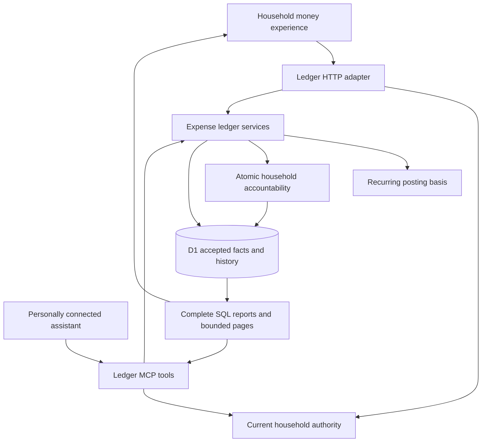
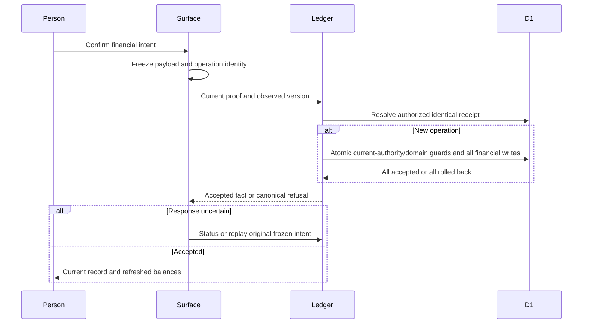
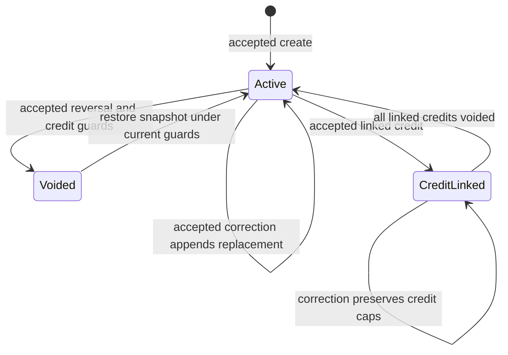
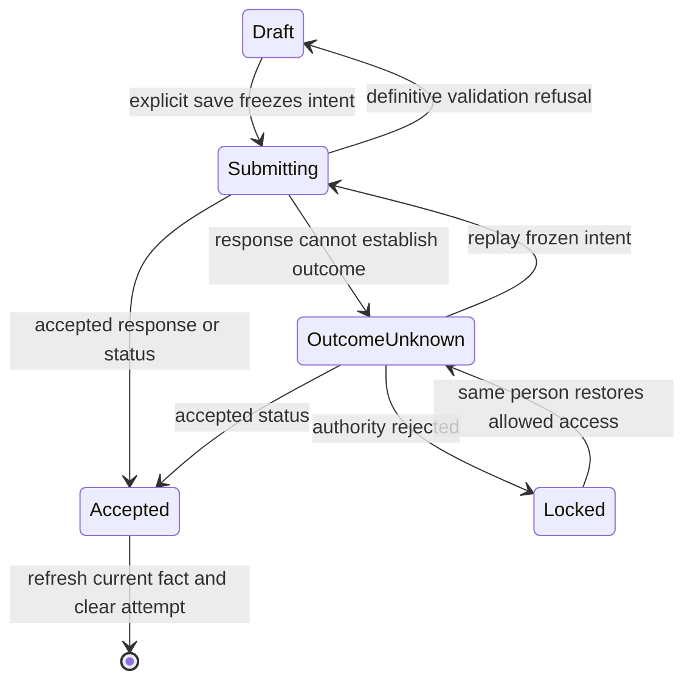
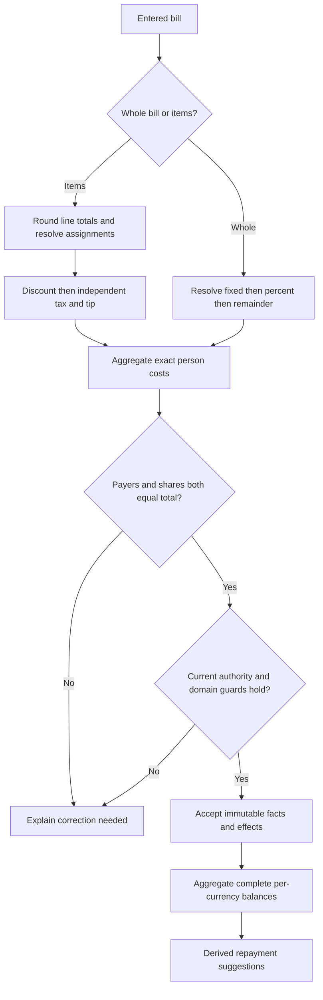

# Advanced Shared Expenses - Plan

## Goal Capsule

- **Objective:** Household members can explain who paid, what each person owes, and which repayments would settle their shared expenses.
- **Means:** An exact-money household ledger, itemized expense entry, and shared app/API/MCP commands (KTD1–KTD14).
- **Authority:** Product requirements govern behavior; Designer-owned `SUBSYSTEM.md` contracts govern boundaries; technical decisions govern implementation within those constraints.
- **Execution profile:** Implement and verify U1–U8 in the isolated feature branch; the caller owns U9 release, merge, and worktree cleanup.
- **Stop conditions:** Surface a contradiction in the financial invariants, materialized subsystem contracts, or current authority boundary before changing it; do not invent a competing balance source.
- **Tail ownership:** Return implemented units and evidence to the caller before review, PR, CI, merge, deployment, and production verification.

---

## Product Contract

### Summary

Add actual shared expenses and recorded repayments alongside existing recurring rules.
The money screens show balances, suggested repayments, itemized bills, flexible splits, a calculator, notes, comments, and retained correction history.
The same accepted records are available through the app, API, and personal MCP connection.

### Problem Frame

The current Expenses screen describes recurring costs and calculates shares, but it records neither actual payer contributions nor repayments.
A recurring rent rule therefore cannot answer whether rent was paid or who currently owes money.
The user needs clear balances and restaurant/grocery bill entry without doing split arithmetic in another app or losing the explanation behind a charge.

### Actors

- A1. An active owner or member records and maintains shared financial facts.
- A2. An active viewer inspects the same household financial facts without changing them.
- A3. A departed household person remains identifiable in old expenses, credits, and repayments without regaining access.
- A4. A personally authorized assistant performs the permitted financial actions under the user's current role and consent ceiling.

### Requirements

**Expense entry and explanation**

- R1. Record an actual expense with its date, description, currency, category, notes, payers, and beneficiaries; payer contributions and resolved beneficiary shares each equal its total.
- R2. Support equal, exact amount, percentage, weighted-share, and mixed splits with visible resolved amounts and deterministic rounding.
- R3. Support itemized bills with per-line amounts, quantities and participant assignments, plus bill-wide discount, tax and tip adjustments that explain the final total and every person's allocation.
- R4. Provide an amount calculator with explicit application of its result; a calculation never saves a financial record by itself.
- R5. Preserve expense notes and immutable, attributed comments; further explanation is appended and comments never change balances.
- R6. Permit copying an expense into a new editable draft; no copied record is accepted until the person saves it.

**Balances and financial lifecycle**

- R7. Show complete per-member balances separately for each currency, with the contributing paid/share/payment breakdown rather than page subtotals masquerading as balances.
- R8. Show deterministic suggested repayments from net debtors to net creditors; suggestions are neither uniquely established original counterparty debt nor executed payments or a global-minimum claim.
- R9. Record partial or full reported repayments with sender, receiver, positive amount, date, currency, method and optional reference; actual reported payments may differ from suggestions or reverse a balance.
- R10. Correct, void and restore financial entries through retained accepted history with visible reversing and replacement effects.
- R11. Record positive linked refunds against an expense, reversing contribution and consumption in its currency while preserving the original overall and per-person credit limits.
- R12. Explicitly post an observed recurring rule for a chosen cadence period with actual payers and date, preserving its rule/share snapshot and one original expense per rule/period forever.

**Finding and using financial records**

- R13. Provide bounded searches, entry detail, comments and revision history, plus spending summaries and member statements with explicit scope and continuation.
- R14. Export CSV/JSON statements whose opening balance plus movements equals closing balance within one currency and declared accepted-history basis.
- R15. Owners and members maintain shared finances while viewers inspect them; current household, actor, role, exact grant and any approved MCP ceiling hold at acceptance, disclosure and authorized replay.
- R16. An identical authorized retry acknowledges the same accepted money once, while an operation ID reused for changed intent is refused.
- R17. Cached financial reads, retained input and uncertain attempts belong to the last admitted person; changes require connected acceptance and failed input never appears as saved money.
- R18. Preserve existing recurring-rule semantics, inventory/offline synchronization, personal OAuth, continuing sessions, household features and notification scheduler behavior.

### Key Flows

- F1. Record a shared bill.
  - **Trigger:** A1 chooses Add expense, Duplicate, or a recurring-period posting.
  - **Steps:** Compose amount/items and payers, inspect exact allocations, submit once, then inspect the accepted entry and changed balances.
  - **Covers:** R1–R4, R6–R7, R12, R16–R17.
- F2. Recover an uncertain save.
  - **Trigger:** The request might have committed but no usable result arrived.
  - **Steps:** Retain the frozen attempt, verify/replay that same intent, then show its accepted record or a definitive refusal before ordinary editing resumes.
  - **Covers:** R16–R17.
- F3. Record money returned or repaid.
  - **Trigger:** A1 opens an expense refund or a suggested/manual repayment.
  - **Steps:** Inspect remaining credit capacity or proposed sender/receiver, enter the reported fact, confirm the effect, and inspect resulting balances/history.
  - **Covers:** R8–R11.
- F4. Explain and export a balance.
  - **Trigger:** A1/A2/A4 selects a person, currency and optional period.
  - **Steps:** Read complete totals, follow contributing entries and comments, traverse consistent statement pages, then export the completed statement.
  - **Covers:** R5, R7–R8, R13–R15.

### Acceptance Examples

- AE1. A pays INR 900 for A/B/C equally; each owes INR 300, A's net is +600 and B/C are −300, and suggestions settle those balances without changing the expense.
- AE2. A/B contribute INR 700/300 to a INR 1,000 bill whose shares are INR 200/800; their nets are +500/−500, independent of how a repayment suggestion is presented.
- AE3. INR 100 split among three equal people resolves to 3,334/3,333/3,333 paise in the recorded participant order; JPY 1 split equally resolves to 1/0/0 yen.
- AE4. A INR 1,000 mixed split fixes A at INR 200, gives B 30% of the original total, and divides the INR 500 remainder by weights 1:3 for C/D, yielding 200/300/125/375 rupees.
- AE5. A INR 300 item assigned to A and INR 700 item assigned to B, with INR 100 discount, 10% tax and INR 90 tip, resolves to INR 1,080 total and A/B shares INR 324/756.
- AE6. Two concurrent INR 60 refunds against a INR 100 expense cannot both be accepted; correcting or restoring related facts cannot bypass cumulative or per-person refund capacity.
- AE7. A payment save commits but its response is lost; editing input cannot silently create another payment, and replay of the frozen operation confirms one financial effect.
- AE8. Two different operation IDs posting the same rule/period produce one original expense; voiding it does not free that period for another original.
- AE9. More than one page of entries contributes to a displayed balance, and a correction during a paged export forces a restart rather than mixing statement bases.
- AE10. A departed person remains in historical balances and can be named in a recorded repayment, while a new ordinary bill cannot newly select that inactive person.

### Scope Boundaries

This release serves the configured household and extends its existing roles and personal MCP boundary.

#### Deferred to Follow-Up Work

- Bank/card imports, executing transfers, payment-provider callbacks, receipt file uploads/OCR, live exchange-rate conversion, external group import, and cross-household group management.
- Offline financial write synchronization and scheduled automatic charge creation; recurring rules remain explicitly posted intentions under R12/R17.
- Editable/deletable comment threads, mentions and new financial push-notification rules; R5 covers attributed append-only explanation.

### Sources

- [Splitwise](https://www.splitwise.com/) grounds balances, recorded settlements, flexible splits and repayment simplification in R2/R7–R9.
- [Splitwise Pro](https://www.splitwise.com/pro) grounds item assignment, expense search and reusable split workflows in R3/R6/R13.
- [tricount features](https://www.tricount.com/features) grounds the embedded calculator and expense/refund/payment distinction in R4/R9/R11.
- [Settle Up tips](https://settleup.io/tips) grounds weighted shares, retained departed participants, positive refund/income behavior, and explicit repayment suggestions in R2/R8/R11.
- Current recurring rule and resolver contracts are `apps/worker/src/expenses/SUBSYSTEM.md`, `catalog/SUBSYSTEM.md`, and `shares/SUBSYSTEM.md`; the new ledger and web money contracts are `apps/worker/src/ledger/SUBSYSTEM.md` and `apps/web/src/ledger/SUBSYSTEM.md`.

---

## Planning Contract

### Assumptions

- The market-informed additions R6 and R9–R14 belong in this expense release; they were inferred from the requested advanced expense experience rather than separately confirmed with the user.
- The configured currencies remain INR, USD, EUR, GBP and JPY, with current two-decimal/zero-decimal precision; this release adds no exchange-rate authority.
- Initial bounded entry capacity is 12 distinct financial participants and 40 item lines, retaining the existing per-entry money maximum; limits are independent and the raw request limit still applies.
- Financial writes remain online. One unresolved attempt may be retained per browser origin, household and admitted person, shared across tabs, for recovery, but it is not an outbox and never auto-posts offline.
- Repayments are records of money the person reports, with editable methods such as cash, bank transfer, UPI and other; the app does not verify an external payment occurred.

### Key Technical Decisions

- KTD1. **One ledger beside the recurring catalog.** Implement `apps/worker/src/ledger` and `apps/web/src/ledger` under the materialized Designer contracts; preserve `/api/v1/expenses` and existing `expenses_*` MCP tools as recurring-rule interfaces. R1/R12/R18.
- KTD2. **Exact bounded money throughout.** New records use integer minor units in the existing currencies, with positive financial totals at most 10,000,000,000 minor units; arithmetic intermediates use BigInt/rational values. A neutral pure module at `shared/ledger-money.ts` owns allocation, item adjustment and exact money formatting for both server and browser, with thin transport/UI adapters and no Worker/environment imports. Format signed aggregate amounts and CSV decimal values from integer quotient/remainder text rather than floating division, preserving every minor unit through the maximum bound. Within the acceptance transaction, the sum of positive totals of all effective financial entries per household/currency must stay at most 9,007,199,254,740,991, counting expenses, credits and repayments once each. This keeps every signed per-person aggregate and its SQL intermediates exact without using floating `TOTAL()`; full-history sums use integer `SUM` with explicit zero for empty sets. The capacity guard covers correction, void and restoration deltas in both affected currencies and rolls back with the command. [SQLite aggregate semantics](https://www.sqlite.org/lang_aggfunc.html). R1–R3/R7/R9–R11/R14.
- KTD3. **One explicit allocation convention.** Persist participant order as part of intent and use it to break equal residuals. Equal/weighted apportionment floors rational shares and distributes residual minor units by descending fractional remainder, then recorded order. Percentage input has at most two decimal places and becomes integer basis points; weighted ratios have at most four decimal places and become positive integer weights bounded at 100,000,000. Exact-only sums equal the total and percentage-only basis points sum to 10,000. For percentage recipients, floor each rational original-total quota, then distribute residual units up to the floor of the collective percentage quota by descending fractional remainder and recorded order; percentage-only therefore allocates the whole total. Mixed mode assigns fixed amounts first, that collectively rounded percentage amount second, then the exact remaining amount to declared weighted/equal recipients. Excess or unassigned residue is an error. Existing recurring resolution and its input-order ties remain unchanged. R2/R18; AE3–AE4.
- KTD4. **Itemized adjustment order is visible.** Quantities are positive decimals at most 1,000,000 with at most three fractional places; each line is rounded half-up from quantity times unit-price minor units, and zero-valued lines are allowed within a positive bill. Resolve each line through KTD3, then aggregate each person's base cost. Apply discount before tax/tip, allocating it pro rata over base costs; tax and tip are independently calculated on the discounted subtotal and allocated pro rata over discounted person costs. Each adjustment accepts a fixed amount or basis-point percentage, with discounts bounded by subtotal and tax/tip rates bounded to 100%. Round a percentage-derived adjustment total half-up once at its stated subtotal basis, then apportion that integer amount by the residual convention in KTD3; tax and tip totals are independently rounded. Reject a zero-total record or a positive adjustment without a positive allocation basis. The displayed formula and final resolved amounts explain rounding; neither global nor per-person amounts may be negative. R3; AE5.
- KTD5. **Calculator is a bounded input parser.** Support decimal literals, parentheses, unary signs, addition/subtraction, multiplication/division and postfix percent without `eval` or executable expressions. Standalone percent divides by 100; in `A ± B%`, percent means B percent of A, while multiplication/division uses the decimal percentage. Use exact rational intermediates and round half-away-from-zero only when applying to the selected currency; show that rounded result on Apply. Reject division by zero, unsupported tokens, overlong/intermediate results and out-of-range final amounts. Bound input to 128 characters, 64 tokens, nesting depth eight and 512-bit rational intermediates. Amount fields still validate their own positive/zero domain after Apply. Changing currency asks the person to review converted precision and recomputes every preview; it never silently treats old minor units as new major units or performs FX. R4/R18.
- KTD6. **Immutable revisions plus current projections.** A new additive migration provides household-scoped entry heads, immutable financial revisions, resolved per-person effects, immutable comments, a household financial revision, and an immutable recurring-source identity. Each immutable financial revision retains its complete resolved snapshot and separately identified transition effects. Heads select current effective snapshot effects for balances and capacity; they never select only the latest correction delta. Correcting 100 to 120 retains a historical transition of −100/+120 while the current fact contributes 120. Void appends a reversal and removes the effective snapshot, and restore reinstates the last effective pre-void snapshot only after current invariants pass. A new operation correcting a voided entry, restoring an active entry or voiding an already voided entry is refused; an identical accepted retry still follows R16. Financial reports derive only effective facts from this one ledger; they never derive from the audit page or a browser cache. Comments have their own accepted identity/history and do not increment financial versions or financial revision. Composite household/member/source foreign keys prevent cross-home references. Entered dates are strict Gregorian dates used for statement scope, while accepted timestamps establish provenance; current balances include all effective accepted records regardless of their entered date. R5/R7/R10–R11/R13/R16.
- KTD7. **All financial conditions share acceptance.** Extend `platform/household-command.ts` and `auth/permissions.ts` with ledger entry/comment entity and action mappings. Reuse `beginCommand` and its actor-plus-complete-intent fingerprint before generating result IDs. Current authority, observed version, current participant eligibility, KTD2 capacity, active original/refund caps and KTD9 source uniqueness remain guarded inside the same D1 batch as heads, effects, revision, receipt, event and safe audit. Every read/replay rechecks exact current authority; authorization failure cannot become a version conflict or successful receipt disclosure. [D1 transactional batch](https://developers.cloudflare.com/d1/worker-api/d1-database/). R10–R12/R15–R16.
- KTD8. **Historical people and positive credits retain their meaning.** New ordinary expenses select active household members of any role; correction may retain its current recorded people after departure but may add only active people. Restore retains the historical snapshot; duplication is a new expense and requires replacement/removal of departed people before save. Repayment parties may be known active or departed household members. Credit receivers come from the original's current payer set and credited beneficiaries from its current share set; sum of active credits is bounded overall and per person by the original. Original corrections recheck those cumulative caps, original void requires no active credit, and credit restore requires an effective original. Revalidate all of these in KTD7's boundary. R6/R9–R11; AE6/AE10.
- KTD9. **Recurring source identity survives rule changes.** A posting selects the observed active rule and an ordinal period at or after its anchor; derive normalized start and exclusive end from the original anchor plus ordinal times interval. Month/year clamping is computed from the original anchor, so Jan 31 produces Feb 28 then Mar 31 and leap years do not drift. Store the accepted rule/version/cadence, normalized start/end and resolved shares; persist unique household/rule/start identity independently of operation ID and rule version, even after void. A changed cadence is a new current basis, but any identical normalized start still resolves to its existing original. The actual expense date is separately declared and may represent late/advance payment for that billing period. R12; AE8.
- KTD10. **Balances explain facts; repayment matching is derived.** For each person/currency, net equals contribution minus allocated consumption plus repayments sent minus received, with linked credits reversing contribution/allocation. Positive means owed to the person. Provide the contribution/share/payment breakdown and currency totals; conservation requires each currency's net sum to be zero. Derive deterministic suggested payments by matching debtor/creditor cumulative-value intervals ordered by stable member ID, using integer overlap amounts; this supports bounded SQL pagination without loading an unbounded member array. It yields a settling plan without claiming a globally minimal count. Recording a suggestion opens an editable payment form and never gates a reported payment on a live suggested amount. R7–R9.
- KTD11. **Statements and pages name their basis.** Statements use effective record expense/payment dates evaluated at the current accepted financial revision: opening is the selected person's effects before the range, movements fall within the inclusive date range, and closing is their sum. Corrections may alter a later statement generated at a new revision; this release does not offer historical time-travel statements. Within each financial response, revision metadata, complete aggregates and returned rows come from one consistent D1 read snapshot, followed by a current-authority disclosure check. Every financial page cursor binds filters and the financial revision; a changed revision requires restart and never silently mixes pages. Financial reads aggregate the complete relevant ledger in SQL, then return bounded rows: default 25, maximum 50; entry detail is one bounded payload and history/comments have continuation. Category/month spending separately reports expense, credit and net totals without counting repayments as spending. R7/R13–R14; AE9.
- KTD12. **Uncertain financial intent stays frozen.** Use the existing member-bound household request/cache/work-lease primitives, but add an explicit retained attempt state around `operationIntent`. Before dispatch, durably retain the exact operation ID and payload under the current identity lease; retention failure prevents sending. Network failure, timeout, 5xx or an unreadable response enters Outcome unknown and disables ordinary edits/new submissions of that attempt. Offer current-authorized own-operation status and replay of the frozen intent; Accepted clears it and opens the current record, while Not found alone does not prove an outstanding request cannot commit. A definitive ordinary validation refusal permits editing; lost authority locks recovery without converting it into a new operation. Use one attempt slot per browser origin, household and admitted person in the existing `householdCache` store under a separate namespace, with transactional acquisition across tabs and current-lease ownership checks; no Dexie version bump or money outbox is needed. Exclude this slot from read-cache pruning. Same-person revalidation preserves it; current-app logout/account switching includes it in explicit pending-work/discard decisions before the existing authorized clearing boundary. A stale transition cannot clear or repopulate a newer person’s slot, and no recovery auto-sends offline. R16–R17; F2/AE7.
- KTD13. **One money surface and primitive transport parity.** Expenses opens actual entries, personal balance summary and Add expense. Tabs separate Expenses, Balances and Recurring rules; entry details link history, comments and refunds. Member statements and exports have stable return navigation and currency/date scope. New HTTP routes under `/api/v1/ledger` and `ledger_*` MCP tools call the same services and schemas. Financial preview is read-only and authoritative create recomputes it. Explicit tool annotations cover correction/void/restore; callbacks never accept actor, household, author or role claims. Existing broad role ceilings govern these ordinary shared commands. R1–R17.
- KTD14. **Bound records and exports without truncation claims.** Enforce the raw 64 KiB request limit, KTD2 money limits, 12 distinct member IDs in the union of payers and beneficiaries, 40 item lines, description/line labels up to 160 characters, category/method/reference up to 200, and notes/comments up to 2,000. Use bulk SQL/JSON bindings rather than per-line/member network lookups and measure D1 plus OAuth KV calls at no more than 50 for success and refusal paths. Statement export pages carry scope, currency and revision; the app assembles a complete download only within 10,000 movement rows and 8 MiB, otherwise asks for a narrower range. CSV quotes fields and neutralizes formula prefixes in human text; numeric columns come from validated money. Cached money copies retain only the latest 20 query pages and 10 entry details per person. [D1 JSON binding](https://developers.cloudflare.com/d1/sql-api/query-json/). R13–R17.

### High-Level Technical Design

The diagrams specify the boundaries and lifecycle; exact helper and table names remain implementation details.

### HTTP and MCP Surface

| Domain meaning | HTTP under `/api/v1/ledger` | MCP primitive |
|---|---|---|
| List/search entries and inspect one | `GET /entries`, `GET /entries/:id` | `ledger_entries_list`, `ledger_entry_get` |
| Preview exact allocations | `POST /preview` | `ledger_preview` |
| Record expense | `POST /expenses` | `ledger_expense_create` |
| Correct, void, restore retained entry | `PUT /entries/:id`, `POST /entries/:id/void`, `POST /entries/:id/restore` | `ledger_entry_correct`, `ledger_entry_void`, `ledger_entry_restore` |
| Record linked credit or reported payment | `POST /refunds`, `POST /payments` | `ledger_refund_create`, `ledger_payment_create` |
| Append/read comments, inspect revisions | `POST /entries/:id/comments`, `GET /entries/:id/comments`, `GET /entries/:id/history` | `ledger_comment_add`, `ledger_comments_list`, `ledger_history_list` |
| Complete balances and suggested repayments | `GET /balances`, `GET /repayments` | `ledger_balances`, `ledger_repayments` |
| Complete spending summaries by month/category | `GET /summaries` | `ledger_summaries` |
| Member statement and export pages | `GET /statements`, `GET /export` | `ledger_statement`, `ledger_export` |
| Explicit recurring-period posting | `POST /rule-postings` | `ledger_rule_post` |
| Resolve own uncertain operation | `GET /operations/:operationId` | `ledger_operation_status` |

The operation-status query exposes only the current person's accepted ledger operation reference/version or Unknown, never a generic receipt, another actor's attempt, or a promise that an in-flight operation was cancelled.
Financial create/correct payloads share discriminated domain validation; corrections preserve entry kind.
An expense can change currency only with complete revalidation and no active linked credit; a payment correction revalidates both currencies' capacity/effects, while a linked credit always retains its original expense's currency.
Comments remain available on retained voided entries.
Summary queries accept the same date/currency/member scope as entries and return complete expense, credit and net-spending totals grouped by month or category at KTD11’s revision basis; repayments are excluded from spending.

### Dependencies and Ownership

U1 supplies exact types and allocation fixtures.
U2 supplies atomic entries and migration foundations.
U3 adds the remaining commands, while U4 may implement read models in separate files after U2.
U5 exposes the completed services to HTTP/MCP.
U6 supplies input/recovery components; U7 integrates the complete financial experience.
U8 verifies the combined product and updates operational documentation; U9 belongs to the caller's release tail.
Concurrent units must keep their explicit file ownership and coordinate shared-file changes through the caller.

### System-Wide Impact and Risks

- Current action admission, command entity/action mappings, receipt replay, consent summaries and MCP discovery gain financial meanings; role controls are tested across every role/ceiling combination.
- Immutable financial revisions and aggregate guard queries share D1 acceptance under KTD7; no prior migration is edited and the new migration does not modify existing household facts.
- Browser snapshots, unresolved attempts and downloaded-statement preparation use current identity leases and the established logout/account-switch clearing boundary.
- No scheduler job or notification fanout is added; existing meal-reminder limits and eligibility remain unchanged.
- Cross-module navigation must not label recurring templates as actual debt, and stale amounts or suggestions remain visibly distinct from accepted current state.

---

## Implementation Units

### U1. Exact allocation and amount-calculator foundation

**Goal:** Establish one explicit monetary contract and matching preview/input behavior before persistence.

**Requirements:** R1–R4/R18; AE3–AE5; KTD2–KTD5/KTD14.

**Dependencies:** Materialized Designer READY contracts.

**Files:** `shared/ledger-money.ts`, `shared/ledger-money.fixtures.ts`; `apps/worker/src/ledger/model.ts`, `validation.ts`, `allocation.ts`; `apps/worker/test/ledger-allocation.test.ts`, `ledger-validation.test.ts`; `apps/web/src/ledger/types.ts`, `allocation-preview.ts`, `calculator.ts`, `calculator.test.ts`, `allocation-preview.test.ts`; existing `apps/worker/test/expense-shares.test.ts`, `apps/web/src/lib/expenses.test.ts`.

**Approach:**
1. Define bounded entry/split/item/refund/payment concepts and resolved allocations per KTD2–KTD5.
2. Make server and browser adapters reuse KTD2’s neutral pure arithmetic module; run independent fixtures/invariant tests at both boundaries rather than maintaining two new allocation engines.
3. Preserve existing recurring resolver behavior and extend its characterization only where a new calculator integrates later.

**Execution note:** Prove conservation and boundary refusals before using these calculations to write money.

**Test scenarios:**
- Covers AE3–AE5. Tiny currency amounts, original-total percentages, weighted remainders and item adjustments resolve exactly.
- Exact/percentage-only under-allocation, duplicate people, missing item assignees and excessive overrides are refused.
- Zero-priced lines, full discounts, zero allocation basis and totals beyond the entry limit produce the specified outcome.
- Rational calculator precedence, unary minus, `100+10%`, `250*18%`, `1/3*3`, JPY rounding and division by zero follow KTD5.
- Token, nesting, bit-size and unsafe-integer inputs fail recoverably without executable evaluation.
- Generated valid split cases conserve payer/share totals and preserve stable residual ordering.
- At the signed aggregate bounds, INR/USD/EUR/GBP decimal formatting, JPY formatting and CSV retain the exact last minor unit.

**Verification:** Server and preview fixtures agree, every valid allocation conserves money, and prior recurring split tests retain their expectations.

### U2. Additive ledger storage and atomic expense lifecycle

**Goal:** Accept actual expenses and their correction/void/restore history exactly once.

**Requirements:** R1–R2/R10/R15–R18; KTD6–KTD8/KTD14.

**Dependencies:** U1.

**Files:** `apps/worker/migrations/0012_expense_ledger.sql`; `apps/worker/src/ledger/repository.ts`, `d1-repository.ts`, `service.ts`; `apps/worker/src/platform/household-command.ts`, `apps/worker/src/auth/permissions.ts`; `apps/worker/test/ledger-service.test.ts`, `ledger-storage.test.ts`, `continuing-authority.test.ts`, `permissions.test.ts`.

**Approach:**
1. Materialize KTD6's heads/revisions/effects/comments/revision/source foundations without changing existing records.
2. Implement expense create/correct/void/restore and ledger command mappings through KTD7's shared acceptance boundary.
3. Enforce current member eligibility and exact aggregate capacity inside acceptance, including currency-changing corrections.

**Patterns to follow:** `platform/household-command.ts`, current mutation guards, composite household-member foreign keys, and expense service concurrency cases.

**Test scenarios:**
- Covers AE1–AE2. Multiple payers and beneficiaries persist one balanced accepted fact with history, receipt and audit.
- Same operation/intent returns one original acceptance; changed intent or actor collides safely.
- Two updates to the same observed version accept at most one; failed guards leave no partial head/effect/revision/receipt/audit.
- Repeated 100→120→90 corrections followed by void/restore preserve all transition history while current balances and capacity count the one effective snapshot.
- Revoke/demote/deactivate between service entry and batch acceptance, including replay paths, and verify no disclosure or mutation bypass.
- Covers AE10. Retained departed people survive correction/restoration, while newly added departed/cross-household people fail.
- Capacity-boundary create/correct/void/restore races remain exact; populated existing household tables and foreign keys survive migration unchanged.

**Verification:** Real D1 tests prove atomic financial lifecycle and current authority; no balance is reconstructed from audit or a mutable browser total.

### U3. Credits, payments, comments and recurring-period posting

**Goal:** Complete the financial command lifecycle and explicit recurring-to-actual transition.

**Requirements:** R5/R9–R12/R15–R16; F3; AE6/AE8/AE10; KTD7–KTD9.

**Dependencies:** U2.

**Files:** `apps/worker/src/ledger/service.ts`, `d1-repository.ts`, `validation.ts`; `apps/worker/src/expenses/catalog/service.ts`, `repository.ts`, `d1-repository.ts`; `apps/worker/test/ledger-credits-payments.test.ts`, `ledger-comments.test.ts`, `ledger-recurring.test.ts`, `expense-service.test.ts`.

**Approach:**
1. Add linked-credit and reported-payment commands with KTD8's current original/party conditions and KTD7's atomic effects.
2. Append current-author-attributed comments independently of financial versions.
3. Expose the recurring catalog's current posting basis and accept one permanent source identity under KTD9.

**Test scenarios:**
- Covers AE6. Concurrent credits, original reductions, void and credit restoration cannot exceed current overall/per-person capacity.
- Covers AE10. Payments involving known departed parties remain possible; foreign-household parties and self-payments fail.
- Partial and overpayments have the exact resulting sign, and correcting/voiding/restoring them reverses or replaces their effects.
- Comment text is attributed to current proof, not a supplied author; comments on voided entries append without changing balances.
- Covers AE8. Different operation IDs and different current rule versions cannot duplicate a normalized rule/period start.
- Jan 31 monthly and Feb 29 yearly cadence periods clamp without drift; changed/archived rules and stale membership are rechecked at acceptance.
- Posted entries retain their rule/share snapshot after later rule edits; voided postings are restored through the original entry before any correction, and direct correction while voided is refused.

**Verification:** All commands use one financial authority, comment-only changes remain nonfinancial, and existing recurring rules continue to mean rules.

### U4. Complete balances, bounded inspection and statements

**Goal:** Explain all accepted money through bounded, consistent queries and exportable statements.

**Requirements:** R7–R8/R13–R17; F4/AE9; KTD10–KTD12/KTD14.

**Dependencies:** U2; U3 command behavior is needed for final integration cases.

**Files:** `apps/worker/src/ledger/queries.ts`, `query-validation.ts`, `query-repository.ts`, `d1-query-repository.ts`; `apps/worker/test/ledger-queries.test.ts`, `ledger-statements.test.ts`, `ledger-query-boundaries.test.ts`.

**Approach:**
1. Aggregate effective financial effects in SQL, then page entries, history, balances and cumulative-interval repayment suggestions per KTD10/KTD11.
2. Bind cursors to canonical filters and the accepted financial revision; reject mixed-basis continuation.
3. Produce reconciling statement/export pages and narrow own-operation status without generic receipt access.

**Test scenarios:**
- Covers AE9. Entries beyond the first page affect complete balances, spending summaries and member statements.
- Expense/credit/payment signs conserve every currency independently, including empty histories and boundary-sized exact aggregates.
- Suggested payments settle each net without a direct-debt matrix or global-minimum claim; stable member ordering yields reproducible pages.
- Backdated correction moves statement opening/range effects at a new revision; old-page continuation refuses rather than mixing snapshots.
- Interleave a correction between revision/aggregate/row reads, including the first page; the response must reconcile at one snapshot or require restart.
- Search, date, category, currency, member and lifecycle filters bind safely; malformed/tampered cursors or cross-household subjects fail.
- Own-operation status returns only accepted ledger references for the current actor; Unknown does not authorize retrying changed intent.
- Comment/history pages remain bounded, and financial capacity/report queries remain within KTD14 including failure paths.

**Verification:** Opening plus movements equals closing, per-currency net sums to zero, and no report mistakes visible-page totals for complete facts.

### U5. HTTP and personal MCP financial parity

**Goal:** Make every ledger action available under the same current authority through direct and connected entry points.

**Requirements:** R1–R17; A1/A2/A4; KTD7/KTD13/KTD14.

**Dependencies:** U3, U4.

**Files:** `apps/worker/src/http/ledger-routes.ts`, `apps/worker/src/index.ts`, `apps/worker/src/mcp/ledger-tools.ts`, `server.ts`, `results.ts`, `apps/worker/src/auth/permissions.ts`; `apps/web/src/auth/connection-consent.tsx` capability summaries where necessary; `apps/worker/test/ledger-api.test.ts`, `mcp-ledger-parity.test.ts`, `mcp.test.ts`, `permissions.test.ts`, `apps/worker/test/d1-budget.ts`; `apps/web/src/auth/connection-consent.test.tsx`.

**Approach:**
1. Implement the KTD13 surface table with shared domain schemas and services; preserve existing recurring endpoints/tools.
2. Add current-role/approved-ceiling discovery and capability summaries, plus explicit financial mutation annotations.
3. Exercise actual personal OAuth admission rather than treating an injected context as complete MCP proof.

**Test scenarios:**
- Every primary action, including month/category summaries beyond the first visible page, has HTTP/MCP outcome parity, exact resulting money and current-version conflict behavior.
- The read-only POST preview remains available to viewers despite using POST; money-changing routes retain their action-specific refusal.
- All nine current-role/approved-role combinations expose only permitted tools, with Viewer writes refused and shared reads allowed.
- Revoke or demote after a read/command starts and before completion; reads and acceptance/replay retain the exact current boundary.
- Payer/comment author/household impersonation, unknown fields and malicious expression payloads cannot create authority.
- Accepted connected changes have non-secret actor/client/tool/operation provenance in history/audit.
- Maximum bounded item/party records and canonical error/replay paths stay within 50 combined D1/OAuth-KV calls.

**Verification:** Direct and connected actors share one ledger and policy, with unchanged old MCP semantics and no operator-bearer acceptance.

### U6. Expense composer, calculator and uncertain-save recovery

**Goal:** Let a person enter and review advanced bills without losing input or duplicating an uncertain save.

**Requirements:** R1–R4/R6/R16–R17; F1–F2/AE3–AE5/AE7; KTD3–KTD5/KTD12–KTD14.

**Dependencies:** U1, U5; design intent may be written while domain units complete.

**Files:** `docs/design/2026-11-19-household-money-ui.md`; `apps/web/src/ledger/api.ts`, `types.ts`, `entry-dialog.tsx`, `item-editor.tsx`, `amount-field.tsx`, `attempt-state.ts`, `ledger.css`; `apps/web/src/ledger/entry-dialog.test.tsx`, `amount-field.test.tsx`, `attempt-state.test.ts`, `api.test.ts`; `apps/web/src/auth/auth-gate.tsx`, `auth-gate.test.tsx` pending-attempt/discard integration; `apps/web/src/components/expense-rule-dialog.tsx` calculator integration and its existing/new tests.

**Approach:**
1. Write design intent matching existing Home OS tokens, then implement clear whole-bill/itemized composition, payer totals and resolved per-person preview.
2. Expose KTD5's calculator in money fields, including reusable recurring-rule entry where appropriate, without changing the recurring resolver.
3. Implement KTD12 through current work leases and member-owned retained attempt state; dirty-input dismissal is deliberate and an uncertain save cannot become an ordinary new draft.

**Test scenarios:**
- Covers AE3–AE5. Whole-bill and per-item forms show exact total, payer remainder and beneficiary allocations before Save.
- Calculator Apply, cancel, keyboard navigation and currency changes preserve explicit amount semantics; invalid expressions never submit.
- Duplicate opens a new draft with today's date and requires departed-party correction before Save.
- Covers AE7. A committed response loss freezes original payload/ID across edits and reload; status/replay recovers exactly one record.
- Persistence failure sends no request; reload immediately after dispatch recovers the durably stored identity, and concurrent tabs for the same browser origin, household and admitted person cannot acquire separate unresolved attempt slots.
- Same-person revalidation retains an unknown attempt, while deliberate logout/account-switch discard and delayed old callbacks follow the exact identity-clearing boundary.
- Ordinary validation errors retain editable input; unknown outcome, 401/403, reconnect and same-person reauthentication preserve the required recovery state.
- A delayed A response cannot clear or repopulate B's form, pending attempt, cache or statement preparation after account switching.
- Dialog focus, labels, error announcements and 320px layout remain usable without nested modal traps.

**Verification:** Financial input remains visibly unsaved until accepted, uncertain saves cannot silently duplicate money, and no financial outbox is introduced.

### U7. Balances, records, payments and financial navigation

**Goal:** Provide a complete daily expense experience with an explainable route from balance to bill and back.

**Requirements:** R5–R15/R17–R18; F3–F4; KTD8/KTD10–KTD14.

**Dependencies:** U6, U5.

**Files:** `apps/web/src/ledger/ledger-view.tsx`, `entry-detail.tsx`, `balances-view.tsx`, `payment-dialog.tsx`, `refund-dialog.tsx`, `statement-view.tsx`, `export.ts`, `ledger.css`; `apps/web/src/components/inventory-app.tsx`, `expenses-view.tsx`, `apps/web/src/lib/navigation.ts`; `apps/web/src/ledger/views.test.tsx`, `entry-detail.test.tsx`, `export.test.ts`; existing `apps/web/src/components/expenses-view.test.tsx`, `inventory-app.test.tsx`, `apps/web/src/lib/navigation.test.ts`.

**Approach:**
1. Integrate KTD13's entry/balance/rule tabs, personal net summary, currency selector, bounded search, source breakdown and stable detail return path.
2. Add editable Record payment and linked-refund dialogs, correction/void/restore confirmation, comments and explicit rule-period posting; all use U6’s durable submission/recovery mechanism before dispatch.
3. Use scoped current-person loading and stable retries for the embedded recurring-rule view; bound cached reads and statement assembly per KTD14.

**Test scenarios:**
- Covers AE1–AE2. The initial screen distinguishes actual accepted expenses, current balance and recurring templates.
- Covers AE10. Historical parties remain readable, ordinary new selection excludes departed people, and copy/restore paths differ correctly.
- Partial/overpayment and stale suggested amounts show the entered payment's effect and never claim a transfer was executed.
- Comments and financial revision history explain a corrected/voided bill without altering amounts themselves.
- Rule posting previews the normalized period and finds its existing original after duplicate/void cases.
- Empty, loading, error, offline-cached and stale-revision states offer a working recovery/back path.
- Statement download completes one basis or cancels on change/size limits; CSV text formulas are neutralized and negative numeric balances remain numbers.
- Viewer controls, all identity-switch lease races, navigation/deep links and dirty-form cancellation preserve current member state.

**Verification:** A user can record a bill, understand a balance, record a repayment, discuss/correct the bill and export its statement through predictable connected flows.

### U8. Integrated financial proof and operational documentation

**Goal:** Prove financial integrity, app/MCP parity and regression safety in a real local stack.

**Requirements:** R1–R18; AE1–AE10.

**Dependencies:** U1–U7.

**Files:** `scripts/ledger-browser-smoke.mjs`, `package.json`, `.github/workflows/ci.yml`; `apps/worker/test/ledger-budget.test.ts` and affected integration fixtures; `README.md`, `docs/requirements.md`, `docs/product-architecture.md`, `docs/deployment.md`; design document self-critique in `docs/design/2026-11-19-household-money-ui.md`.

**Approach:**
1. Add a portable isolated-D1/Chrome/official-client proof for actual bills, itemization, comments, payments, credits, corrections, source uniqueness and statements.
2. Integrate the ledger browser gate and artifact upload into CI without weakening existing PWA/MCP/household checks.
3. Update the product ledger, API/MCP operation descriptions and deployment pre/postflight with the actual implemented scope and query methods that return aggregate rows, preserving the existing forward-correction policy instead of a routine database restore that would lose later ledger facts or receipts.

**Test scenarios:**
- Real owner/member/viewer browser/API/MCP actors observe the same amounts after each representative command and refusal.
- Create a multi-payer itemized bill, record partial payment/credit, correct/void/restore where permitted, and reconcile each statement and currency.
- Reconnect after a deliberately lost accepted response; verify one operation, one financial effect and one accepted audit cause.
- Existing installation loads the new shell explicitly without discarding inventory queues; cached financial reads reopen offline and writes remain disabled.
- Install the prior deployed `8f45806` app against the migrated local stack and prove continuing sessions, added capabilities and inventory queue recovery remain compatible; keep the separate `102af58` legacy nullable-session migration fixture frozen.
- Test 320px/390px/desktop layouts, keyboard flows, form focus, download limits and zero uncaught browser errors.
- Run every existing suite, real HTTP smoke, household journeys, personal MCP/session proof and legacy installed-PWA upgrade gate.

**Verification:** Quality gates pass on the integrated candidate; local fixtures/profiles/processes are removed and evidence states any production-only verification limitation.

### U9. Caller-owned merge, production rollout and cleanup

**Goal:** Put the verified ledger on the existing primary domain without changing household identity or secrets.

**Requirements:** R15/R18.

**Dependencies:** U8, completed review and green current-head CI.

**Files:** Production `0012_expense_ledger.sql`, existing Worker configuration, release evidence under current conventions, `docs/deployment.md`.

**Approach:**
1. Follow the caller's authorized review/PR/merge workflow, preserving the plan and materialized subsystem meaning.
2. Confirm access to the existing Home OS Cloudflare account, record non-secret preflight counts/schema and use the operator's current backup policy before the additive migration.
3. Deploy the actual merged build with its SHA/version and preserve setup/pepper/VAPID/OAuth KV resources and the existing cron.
4. Verify primary-domain health/readiness, new anonymous ledger protection, PWA/OAuth assets and schema integrity; use an existing controlled identity only when available.
5. Prove landing, clean worktree and no live use before removing the feature worktree/branch; preserve unrelated user plans and release evidence.

**Test scenarios:**
- Public release and migration checks identify the merged SHA, and old household tables/counts and foreign keys remain intact.
- With an existing controlled production identity, a permitted reversible financial flow and MCP read agree; otherwise record this live authorized check as unavailable and retain actual local integration proof.
- No production owner/test password is created, no credential is logged, and notification configuration remains unchanged.

**Verification:** The caller records merged/deployed identifiers, truthful live evidence and cleanup, or a concrete external blocker without claiming the release complete.

---

## Verification Contract

Planning runs no implementation tests and makes no new pass claim.
Use the repository's supported Node 22.23.5 for execution.

| Gate | Applies to | Required evidence |
|---|---|---|
| `npm test` | U1–U8 | Prior tests and financial invariants pass without weakening assertions |
| `npm run lint` | U1–U8 | Web lint and Worker strict TypeScript checks pass |
| `npm run build` | Integrated candidate | Static PWA and Worker dry-run package build with actual schemas/bindings |
| `npm run smoke` | Integrated candidate | Existing real-Worker authentication/household HTTP proof stays green |
| `npm run smoke:browser` | U7–U8 | Existing household browser journeys stay green |
| `npm run smoke:mcp` | U5/U8 | Personal OAuth, role/ceiling/session boundary evidence stays green |
| `npm run smoke:upgrade` | U8 | Legacy installed-PWA queued-work recovery stays green |
| New `npm run smoke:ledger` | U8 | Actual financial UI/API/MCP, uncertain response and statement reconciliation proof |
| Ledger budget assertions | U2–U5/U8 | Worst bounded success/refusal/replay calls use no more than 50 combined D1/OAuth-KV requests |
| Independent code/security/data review and CI | U8–U9 | Material findings resolved; current reviewed head passes required gates |
| Production schema/public/controlled checks | U9 | Correct merged release identified, financial protection and existing configuration preserved |

---

## Definition of Done

- The complete R1–R18 outcome is implemented or a concrete blocker is reported; narrower partial ledger behavior is not described as the requested advanced expense feature.
- Every accepted financial command conserves currency value and joins exact current authority, immutable history, effects and retry acknowledgement in one acceptance boundary.
- Role/ceiling parity, departed-party behavior, concurrent credits/source posting, uncertain attempts and statement revision consistency have outcome-level evidence.
- Actual records, recurring intentions, suggestions, calculator results, retained drafts and reported external payments remain visibly distinct.
- Existing household/PWA/OAuth/session behavior passes its prior gates and no new scheduler or financial outbox is introduced.
- The app has a written design intent and completed usability/visual self-critique for its new financial flows.
- U1–U8 return verified code and evidence; U9 records the reviewed merged/deployed release and removes the landed worktree under the active repository instructions.
- Remove abandoned implementations, temporary experimental code, fixture processes and isolated browser profiles before completion.
